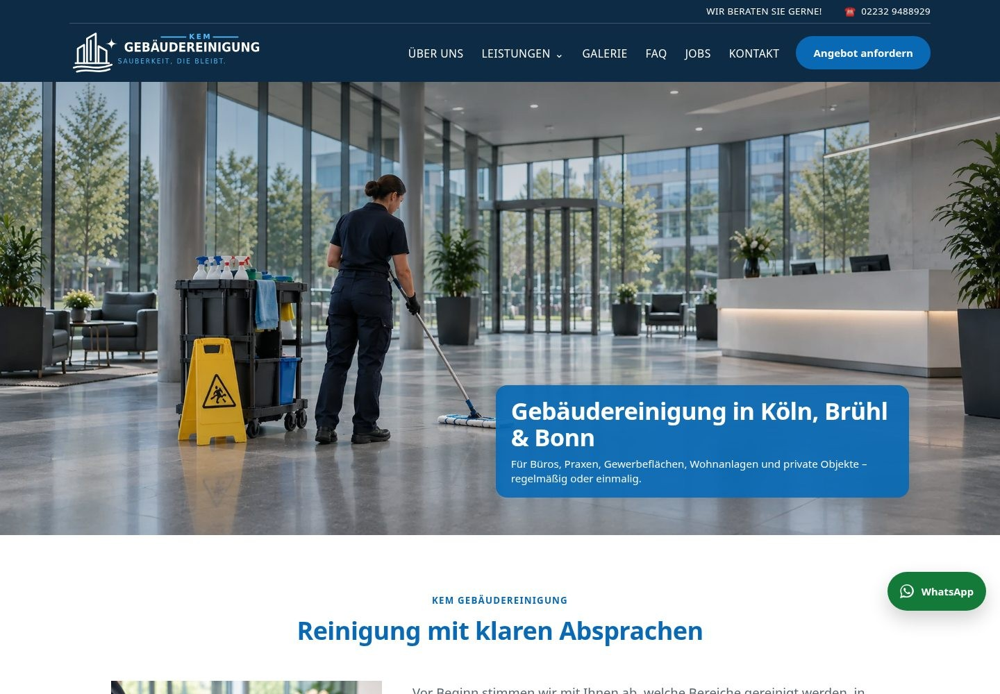
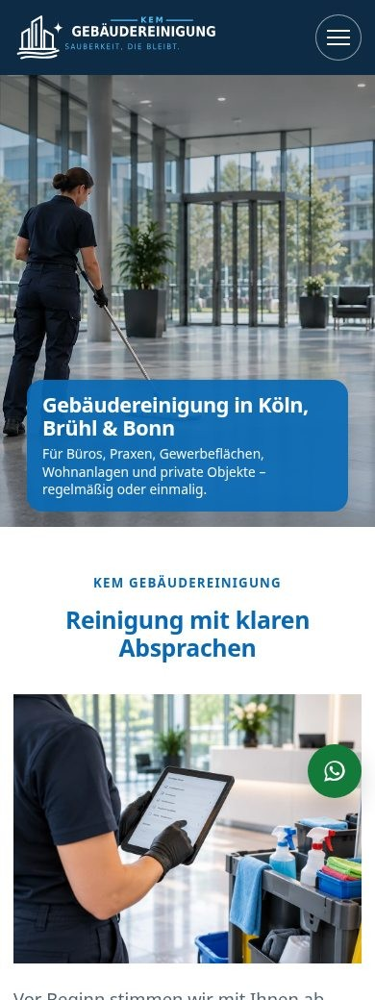
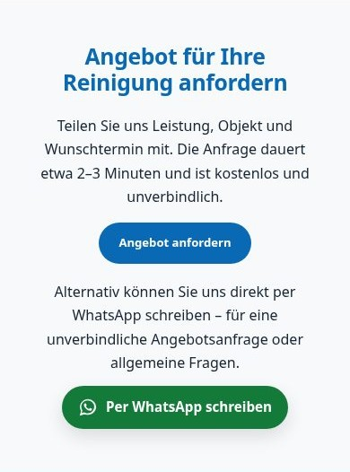
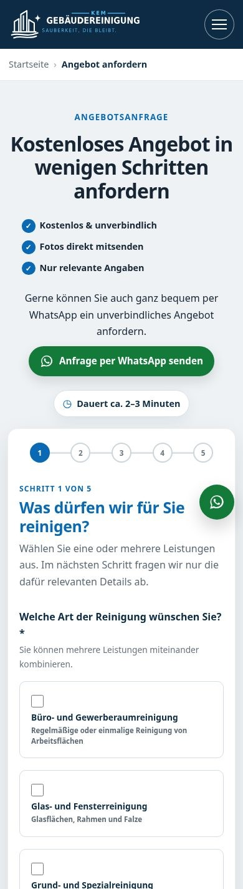
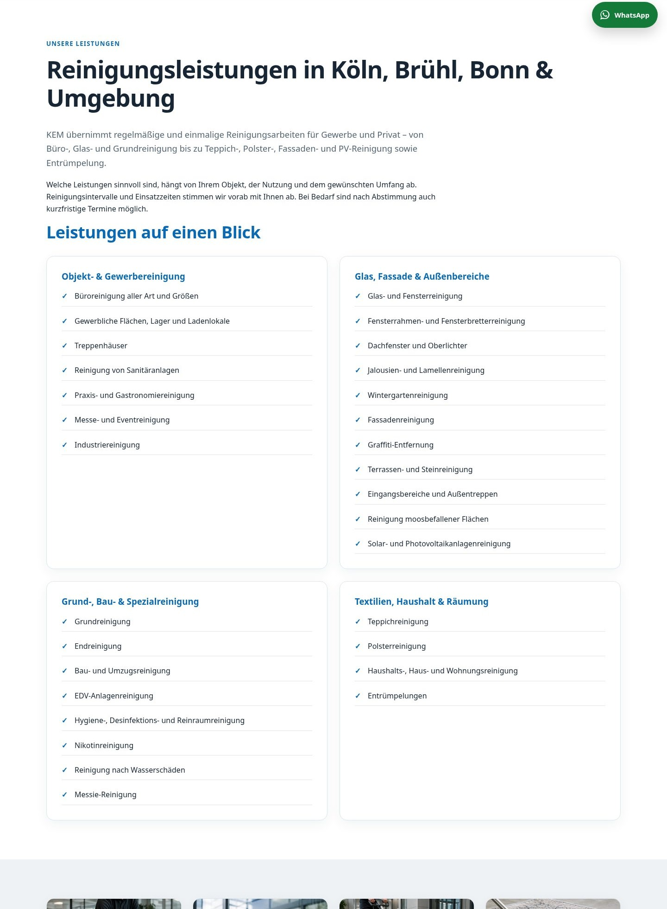
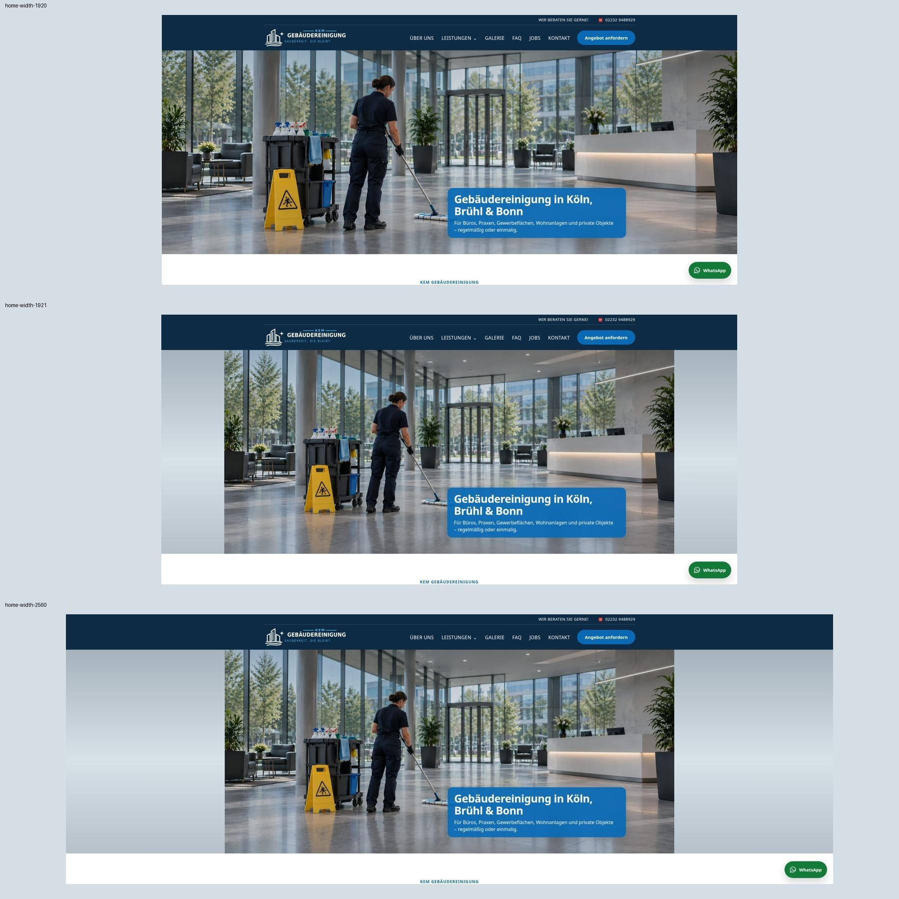

# KEM Gebäudereinigung – Deep Design Audit

**Audit vom 14. Oktober 2026 · Basis: `final` · Arbeitsbranch: `final2`**

**Geprüfter Commit:** `00f1fe3b7750e0315f3ec0224a887f1a0e74b2d1`  
**Repository:** `kiesmo/kem-website`  
**Quellcode-Abgleich:** 14. Oktober 2026, auf exakt demselben Commit; lokale Arbeitskopie `final2`, identisch mit `origin/final`.  
**Bereitstellungsbranch:** `audit/design-final2` – ausschließlich Audit-Dokumentation und Screenshot-Belege.  
**Auftrag:** Ausführliche Prüfung von Layout, visueller Hierarchie, Typografie, Farben, Inhaltsstruktur, Seitenaufbau, primären und abschließenden CTAs sowie angrenzenden Design- und UX-Themen. Keine Änderung an der Website.

> Die Website besitzt eine brauchbare, konsistente gestalterische Grundlage. Der größte Verbesserungsbedarf liegt in der Reihenfolge und Gewichtung der Inhalte: Bilder beanspruchen viel Platz, der Einstieg in eine Angebotsanfrage erscheint häufig spät, und WhatsApp erhält teilweise mehr visuelle Aufmerksamkeit als das als primär angelegte Formular. Die Empfehlung ist eine gezielte Überarbeitung der Hierarchie auf Basis des bestehenden Designs.

## Inhalt

1. [Prüfumfang und Aussagekraft](#1-prüfumfang-und-aussagekraft)
2. [Wichtigste Entscheidungen und Prioritäten](#2-wichtigste-entscheidungen-und-prioritäten)
3. [Was ausdrücklich bleiben sollte](#3-was-ausdrücklich-bleiben-sollte)
4. [Visuelle Hierarchie und Aufmerksamkeitsführung](#4-visuelle-hierarchie-und-aufmerksamkeitsführung)
5. [Typografie und typografische Skala](#5-typografie-und-typografische-skala)
6. [Farben, Kontrast und Oberflächen](#6-farben-kontrast-und-oberflächen)
7. [Layout, Abstände und responsive Struktur](#7-layout-abstände-und-responsive-struktur)
8. [Inhaltshierarchie und CTA-System](#8-inhaltshierarchie-und-cta-system)
9. [Angebotsformular und Interaktionszustände](#9-angebotsformular-und-interaktionszustände)
10. [Navigation, Links und schwebende Elemente](#10-navigation-links-und-schwebende-elemente)
11. [Bildsprache, Marke und visuelle Qualität](#11-bildsprache-marke-und-visuelle-qualität)
12. [Audit nach Seitentyp und einzelner Route](#12-audit-nach-seitentyp-und-einzelner-route)
13. [Vorgeschlagene Designregeln und Seitenstruktur](#13-vorgeschlagene-designregeln-und-seitenstruktur)
14. [Umsetzungsreihenfolge und Abnahmekriterien](#14-umsetzungsreihenfolge-und-abnahmekriterien)
15. [Offene Validierung und Belege](#15-offene-validierung-und-belege)
16. [Quellcode-Abgleich und Dokumentkorrekturen](#16-quellcode-abgleich-und-dokumentkorrekturen)

## 1. Prüfumfang und Aussagekraft

### 1.1 Vorgehen

`final` wurde aus dem GitHub-Repository geholt und ausgecheckt. Anschließend wurde `final2` direkt von diesem Commit erstellt. Die Prüfung erfolgte am lokalen, unveränderten PHP-/Apache-Rendering dieser Version. Vorhandene ältere Audit- und Preview-Dateien wurden nicht als Ersatz für die aktuelle Prüfung verwendet.

Geprüft wurden:

- **28 Routen**, einschließlich der direkten 404-Seite, jeweils bei **1440 × 900 px** und **390 × 844 px**: insgesamt 56 vollständige Seitenaufnahmen und DOM-/Layout-Erhebungen.
- **54 zusätzliche Layoutprüfungen** auf Startseite, Glas-/Fensterreinigung und Angebotsanfrage: jeweils 320, 360, 390, 560, 561, 768, 820, 821, 980, 1024, 1080, 1081, 1180, 1365, 1366, 1920, 1921 und 2560 CSS-Pixel Breite bei 900 px Höhe.
- Zusätzliche kurze bzw. schmale Viewports und eine Reflow-Simulation; Einzelheiten in Kapitel 15.
- Mobiles Menü, Leistungs-Dropdown, FAQ-Akkordeon, Tastaturfokus, Formularauswahl, alle fünf Formularschritte, neun bedingte Leistungszweige, Mehrfachauswahl, Flächenschätzung, konkreter Termin, Foto-Vorschau, Prüfübersicht und Rücksprung über „Ändern“.
- Simulierte Fehler- und Erfolgsantwort im Formular. Die beiden betreffenden POST-Anfragen wurden im Browser abgefangen und lokal beantwortet. **Es wurde keine Anfrage an den Kontakt-Backend-Endpunkt übermittelt und keine Nachricht versendet.**
- Design-Tokens, die zehn CSS-Quelldateien, gemeinsame Templates, relevante Seiteninhalte und die zugehörige Interaktionslogik.

Lazy-Loading-Bilder wurden durch Scrollen und Warten auf Dekodierung geladen. Dadurch werden außerhalb des ersten Viewports noch nicht geladene Bilder nicht fälschlich als defekt bewertet.

### 1.1a Ergänzender Quellcode-Abgleich

Die Kapitel 1–15 dokumentieren die ursprüngliche visuelle Prüfung. Der ergänzende Abgleich dieser Fassung verwendet den exakten Commit `00f1fe3b7750e0315f3ec0224a887f1a0e74b2d1`, alle zehn CSS-Module, gemeinsame Renderer/Templates, die 28 Routenkonfigurationen, relevante Inhalte, beide JavaScript-Dateien sowie Formularschema und serverseitige Validierung. GitHub bestätigt, dass `final` diesem Commit entspricht und `audit/design-final2` davon nur die ursprüngliche MD-Datei und sechs Screenshot-Belege ergänzt. Die hochgeladene MD-Datei ist bytegleich mit dieser Repository-Fassung.

Alle 74 unterschiedlichen voll ausgeschriebenen Quellpfade/Quellmuster im ursprünglichen Audit existieren. Das eingecheckte CSS-Bundle entspricht exakt der sortierten Zusammensetzung der zehn Quellen. Die festen Farbpaare in Kapitel 6 wurden unabhängig nachgerechnet und stimmen auf zwei Nachkommastellen.

Zusätzlich wurde die originale Angebotsformular-Komponente mit unverändertem HTML-Anteil, CSS und JavaScript in lokalem Chromium geprüft. PHP-Blöcke waren dabei ausgelassen, Ressourcen wurden aus der Arbeitskopie bereitgestellt und POST-Anfragen blockiert; es gab **null POST-Anfragen**. Bestätigt wurden die Label-Kaskade, Sichtbarkeit/Pflichtfelder aller neun Zweige, native Validierung kurzer Texte sowie das unterschiedliche Verhalten von Datei-Picker und Drag-and-drop. Dies ist eine Komponentenprüfung, kein vollständiges PHP-/Apache-Rendering und kein Backend-Test.

**Die ursprünglichen Seitenhöhen, y-Positionen, HTTP-Antworten, Video-Abspieltests und vollständigen Responsive-Durchläufe wurden in dieser Überarbeitung nicht erneut erhoben.** Sie bleiben historische Messwerte des unveränderten Prüfcommits und sind keine neue Laufzeitfreigabe. Die sechs ursprünglichen Bilder wurden unverändert wiederhergestellt; neue Screenshots werden nicht als Belege des Erst-Audits ausgegeben.

### 1.2 Zielannahme

Die Empfehlungen behandeln die **Angebotsanfrage über das Formular als primäre Aktion** und WhatsApp als gut sichtbare Alternative. Das entspricht unter anderem dem Kommentar zum CTA-System in `resources/css/09-local-pages.css` und den vorhandenen Header-/Abschluss-CTAs. Beide Kanäle können wirtschaftlich wertvoll sein. Falls WhatsApp nachweislich der bevorzugte und besser konvertierende Kanal ist, muss die Zielhierarchie entsprechend angepasst werden; das lässt sich aus dem Design allein nicht entscheiden.

Für die Jobs-Seite gilt ein anderer Hauptzweck: **Bewerbung statt Reinigungsangebot**. Kontakt-, FAQ- und Rechtsseiten benötigen ebenfalls eine ihrem Zweck angemessene Gewichtung.

### 1.3 Befundarten und Prioritäten

| Kennzeichnung | Bedeutung |
| --- | --- |
| **Befund** | Im aktuellen Rendering, DOM oder Quellcode nachgewiesen. |
| **Designurteil** | Fachliche Bewertung der Wahrnehmung und Hierarchie; kein gemessener Conversion-Verlust. |
| **Hypothese / validieren** | Mögliche Wirkung oder noch ungeklärte Tatsache; benötigt Nutzertest, Geschäftsdaten oder echte Unternehmensbelege. |
| **P1** | Zuerst bearbeiten: Kernhandlung, Orientierung oder deutliches visuelles Verhalten betroffen. |
| **P2** | Danach bearbeiten: Lesbarkeit, Konsistenz, Informationsarchitektur oder Interaktionsqualität. |
| **P3** | Optionaler Feinschliff oder gezielte Weiterentwicklung nach den grundlegenden Korrekturen. |

Es wurde kein P0-Befund im Sinne einer belegten, vollständigen visuellen Blockade des Hauptprozesses festgestellt. Eine formale WCAG-Zertifizierung, Cross-Browser-Freigabe, Rechtsprüfung oder Conversion-Messung ist dieses Audit nicht. Insbesondere echte Mailzustellung, reale Erfolgsantworten, Unternehmensreferenzen und Bildherkunft wurden nicht verifiziert.

### 1.4 Belastbare positive Prüfergebnisse

- Alle 27 regulären Routen lieferten lokal HTTP 200, `/404.php` HTTP 404.
- Alle 28 Dokumente enthalten genau eine H1. Mehrere H1 sind hier **kein** bestehendes Problem.
- Nach Laden der Lazy-Loading-Bilder wurden in den 56 vollständigen Durchläufen keine defekten ``-Assets und keine JavaScript-Seitenfehler erfasst.
- Die Hauptdurchläufe und zusätzlichen Breitenprüfungen zeigten keinen tatsächlichen horizontalen Seitenüberlauf. Die zwei zunächst auffälligen Elemente auf Kontakt- und Angebotsseite gehören zum absichtlich außerhalb des Bildschirms liegenden Honeypot.
- Das Formular lässt den gesamten geprüften Ablauf bis zur Prüfübersicht zu. Die Auswahlen bleiben beim Rücksprung über „Ändern“ erhalten.
- Alle neun Leistungszweige aktivieren das zugehörige Detailpanel und passende Pflichtfelder. Die ergänzende Komponentenprüfung bestätigt diese Aktivierung. Das ist eine erhaltenswerte Grundlage; eine vollständige Übereinstimmung aller Wertgrenzen zwischen Browser und Backend folgt daraus nicht, siehe F30.

## 2. Wichtigste Entscheidungen und Prioritäten

| Reihenfolge | Befund | Entscheidung | Priorität |
| --- | --- | --- | --- |
| 1 | F01, F34 | Angebotsanfrage im ersten sichtbaren Bereich der Startseite und auf Mobil direkt erreichbar machen. | P1 |
| 2 | F02 | Hero-Höhe nach Seitenaufgabe staffeln; auf Kontakt-, FAQ- und Leistungsübersicht den Nutzinhalt früher zeigen. | P1 |
| 3 | F03 | Primären Angebotsbutton im Abschlussbereich gegenüber WhatsApp klar priorisieren. | P1 |
| 4 | F26 | Einstieg in das Angebotsformular verkürzen; erste Auswahl deutlich früher sichtbar machen. | P1 |
| 5 | F05 | Auf `/leistungen/` klickbare Leistungen vor den langen Leistungslisten zeigen. | P1 |
| 6 | F19 | Den abrupten `cover`/`contain`-Wechsel bei 1921 px beheben. | P1 |
| 7 | F13, F14 | Fokusindikator und Erkennbarkeit von Eingabefeldern kontraststärker gestalten. | P1 |
| 8 | F33 | FAQ-Navigation nur einmal als aktuelle Seite markieren. | P2; kleiner, konkreter Fix |

Die Wirkung auf Abschlussraten ist eine plausible Hypothese. Die Reihenfolge basiert auf Nähe zur Kernhandlung und sichtbarer Reibung, nicht auf vorhandenen Funnel-Daten. Diese Punkte sollten vor einem Schriftwechsel, neuen Animationen, zusätzlichen Dekorationsfarben oder einer kompletten Neugestaltung bearbeitet werden.

## 3. Was ausdrücklich bleiben sollte

| Element | Warum es funktioniert | Was dabei erhalten bleiben sollte |
| --- | --- | --- |
| Navy-Header und Navy-Footer | Stabiler Markenrahmen, guter Kontrast zu weißen Inhaltsflächen. | Grundfarbe und ruhige Flächenwirkung. |
| Blau als Hauptfarbe | Passend zum Reinigungsangebot; konsistent über Überschriften und Aktionen. | Bestehendes `#0969b5`, soweit konkrete Kontrast-/Hierarchieanforderungen erfüllt bleiben. |
| Systemschrift | Gut lesbar, schnell verfügbar, kein externer Font nötig. | Schriftfamilie zunächst behalten; Hierarchie durch Größe und Gewicht verbessern. |
| Begrenzte Inhaltsbreite | `--max: 1240px` verhindert beliebiges Auseinanderlaufen. | Containerprinzip und konsistente Außenkanten. |
| Design-Tokens | Bereits gemeinsame Größen, Farben, Radien und Abstände vorhanden. | Token-Architektur; Ausnahmen anschließend reduzieren. |
| Helle Flächen und Weißraum | Seriös, sauber und für den Service angemessen. | Ruhige Grundhaltung; Weißraum zielgerichteter einsetzen. |
| Service-Katalog mit acht Kernleistungen | Angebot ist übersichtlich kategorisierbar. | Inhalte und direkte Leistungsrouten. |
| Eigene Leistungsseiten | Gute Grundlage für spezifische Inhalte und passende Anfragekontexte. | Seitentyp und einheitliche Informationslogik. |
| Lokaler Bezug | Brühl als Sitz, Köln und Bonn als Einsatzgebiete werden verständlich genannt. | Ehrliche Unterscheidung zwischen Sitz und Einsatzgebiet. |
| Praxisvideos | Zeigen Tätigkeit konkreter als reine Werbeaussagen. | Videoformat, manuelle Wiedergabe, Poster und `preload="none"`. |
| Native FAQ-Akkordeons | Kompakte Struktur und eingebautes Tastaturverhalten. | `
/
` sowie Plus-/Minus-Zustand. |
| Bedingtes Angebotsformular | Es fragt die ausgewählten Leistungen statt sämtliche Spezialdetails gleichzeitig ab. | Selektive Panels, Mehrfachauswahl und vollständige Prüfübersicht. |
| „Weiß ich nicht“-Option | Verhindert, dass unklare Flächenangaben den Prozess unnötig blockieren. | Vor-Ort-Schätzung und verständliche Erklärung. |
| Foto-Vorschau und Entfernen | Nutzer können die gewählten Dateien nachvollziehen und korrigieren. | Vorschau, Dateiname, Größenangabe und Entfernen-Funktion. |
| Klare Pflichtfeldkennzeichnung | Stern und zusätzliche Erklärung helfen bei der Dateneingabe. | Aussagekräftige, sichtbare Labels statt Platzhalter als Ersatz. |
| Datenschutz-Link im Formular | Sichtbar und separat erreichbar. | Sichtbarkeit und Verlinkung; Textgewicht verbessern. |
| Skip-Link und Reduced Motion | Grundlegende Zugänglichkeit ist bereits berücksichtigt. | Funktion vollständig erhalten; Fokuskontrast verbessern. |
| Klickbare Telefon-/E-Mail-Adressen | Direkter Kontakt ohne Umweg. | `tel:`-/`mailto:`-Links. |
| Mobiles Menü mit Escape und Fokusführung | Solide Interaktionsgrundlage. | Scroll-Lock, Fokusbegrenzung und Rückgabe des Fokus. |
| Verbergen des Floating-WhatsApp beim Footer | Reduziert Konkurrenz im unteren Kontaktbereich. | Grundidee; Übergänge und Seitenkontexte weiter prüfen. |
| Jobs-CTA per E-Mail | Passt zum Bewerbungszweck. | Eigene Bewerbungsaktion statt Umleitung ins Reinigungsformular. |
| 404-Seite | Klare Erklärung und zwei sinnvolle Rückwege. | Fehlertext, Startseiten- und Leistungslink. |

**Nicht automatisch ändern:** Logo, komplette Farbpalette, sämtliche Fotos, Systemschrift oder alle Karten. Für diese großen Eingriffe fehlt derzeit ein zwingender Designbefund. Der Bericht nennt gezielte Verbesserungen und Bedingungen für einen sinnvollen Austausch.

## 4. Visuelle Hierarchie und Aufmerksamkeitsführung

### F01 · Startseiten-Hero zeigt keine primäre Handlung · P1

**Befund:** Das Hero enthält H1 und Subline, aber keinen Angebotsbutton. Am Desktop ist die Anfrage im Header erreichbar. Unter 1081 px wird dieser Header-CTA ausgeblendet. Auf der mobilen Startseite liegt der erste sichtbare Formular-CTA außerhalb des Menüs bei etwa **y = 6213 px**. Im anfänglichen Viewport steht dagegen WhatsApp als Floating-Aktion bereit.

**Designurteil:** Bild und Leistungsbeschreibung sind verständlich, aber die gewünschte nächste Handlung entsteht nicht an derselben Stelle. Wer bereits anfragen möchte, muss das Menü öffnen oder weit scrollen. Das ist eine unnötige Trennung zwischen Verständnis und Aktion.

**Ändern:** Im Hero einen klaren Button „Kostenloses Angebot anfordern“ ergänzen, darunter knapp „Kostenlos & unverbindlich“. Einen zurückhaltenderen Weg „Leistungen ansehen“ nur hinzufügen, wenn er die Hauptaktion nicht verdrängt. Der Angebotsbutton sollte im gesamten ersten Bereich der Startseite erreichbar sein.

**Behalten:** Motiv, regional verständliche H1, Zielgruppen-Subline und grundsätzlicher Bild-/Text-Kontrast.

**Abnahme:** Bei 390 × 844 und 320 × 568 px ist eine Formular-Anfrage ohne Öffnen des Menüs und ohne Scrollen erkennbar erreichbar. Text und Button überdecken die relevante Reinigungstätigkeit nicht.

**Quelle:** `public_html/index.php:9`, `resources/css/04-responsive.css:58`, `resources/css/09-local-pages.css:138`.

### F02 · Unterseiten verwenden eine zu ähnliche, große Hero-Fläche · P1

**Befund:** Viele Unterseiten beginnen mit einem 653 px hohen Bild bei 1440 px Breite. Danach folgen Breadcrumbs, Abschnittsabstand und Eyebrow. Auf Leistungsübersicht, Kontakt und Glas-/Fensterreinigung beginnt die eigentliche H1 erst bei etwa **y = 938 px**, außerhalb des 900 px hohen ersten Viewports. Das Bildlabel ist zwar früher sichtbar, enthält aber weder zentrale Details noch eine primäre Aktion. Auf Mobil liegt das Bild bei 470 px Höhe.

**Designurteil:** Ein ausdrucksstarkes Bild ist auf der Startseite sinnvoll. Auf Kontakt oder FAQ wollen Besucher oft sofort eine Adresse, eine Antwort oder ein Eingabefeld finden. Die gleiche Bildhöhe behandelt unterschiedliche Aufgaben zu gleichförmig.

**Ändern:** Drei Hero-Varianten definieren: Startseite mit Bild und Handlung; Leistungs-/Standortseite mit kompakterem, informationshaltigem Einstieg; Kontakt/FAQ/Recht/Angebot als sachlicher Utility-Einstieg mit geringem Bildanteil oder ohne großes Foto. Die H1 stärker mit Einleitung und Anfrageoption zusammenführen.

**Behalten:** Gute Motive und Bildlabels als Orientierung, wo sie die Aufgabe unterstützen.

**Abnahme:** Der erste Viewport enthält den eigentlichen Seitentitel und einen Teil der entscheidenden Information. Kontaktangaben bzw. FAQ-Einstieg sind früher erreichbar. Eine kürzere Hero-Fläche darf kein beliebiges Abschneiden wichtiger Bilddetails erzeugen.

**Quelle:** `resources/css/02-components.css:272`, `resources/css/09-local-pages.css:271`, gemeinsame Hero-Ausgabe in `app/helpers/render-components.php`.

### F03 · Sekundärer WhatsApp-CTA erhält mehr visuelles Gewicht · P1

**Befund:** Auf der Startseite ist der finale Angebotsbutton ungefähr **169 × 46 px**, Schrift **13,12 px**, ohne ruhenden Schatten. Der WhatsApp-Button ist etwa **252 × 48 px**, Schrift **15,2 px**, mit Icon und Schatten. Auf der Angebotsseite ist die WhatsApp-Aktion im Einstieg sogar etwa 298 px breit. Die größere Breite entsteht teilweise durch den Text, die Gewichtung zusätzlich durch die Stile.

**Designurteil:** Die erklärte Hauptaktion ist auf mehreren Seiten die visuell kleinere Aktion. Die grüne Farbe muss nicht entfernt werden; Größe, Gewicht und Schatten sollten dem Handlungsrang folgen.

**Ändern:** Einen echten Primary-Button mit gut lesbarer Schrift, ausreichender Höhe und stärkerem Gewicht definieren. WhatsApp als sekundäre Aktion etwas ruhiger gestalten und näher an einer kurzen Alternative-Erklärung platzieren. Im Formular den Wechsel zu WhatsApp nicht vor die erste Eingabe stellen.

**Behalten:** WhatsApp-Verfügbarkeit, das erkennbare Symbol und den ausreichenden Textkontrast des bestehenden Grüntons.

**Abnahme:** Der Angebotsbutton ist in einem kurzen visuellen Scan die eindeutige Hauptaktion des Abschlussblocks. Beide Kanäle bleiben verständlich, aber nicht gleich laut.

**Quelle:** `resources/css/02-components.css:2`, `resources/css/03-pages.css:398`, `content/ctas/startseite.php`.

### F04 · Acht gleich gewichtete Startseiten-Karten verlängern Mobil erheblich · P2

**Befund:** Der Leistungsbereich ist bei 390 px etwa **2851 px** hoch. Acht Karten stehen untereinander, überwiegend mit 300 px Mindesthöhe, großem Icon und zentriertem Text. Sie belegen damit einen erheblichen Teil der 7592 px hohen Startseite.

**Designurteil:** Gleichgewicht signalisiert ein breites Angebot, erzeugt aber wenig Priorisierung. Große Icons und Kartenhöhen sind für die Orientierung weniger wichtig als Leistungsname und kurzer Nutzen. Das visuelle Muster wiederholt sich lange, bevor die Abschlussaktion erscheint.

**Ändern:** Mobile Karten in kompakte, gut anklickbare Service-Zeilen oder kleinere Karten umwandeln. Falls Geschäftsdaten bestimmte Hauptleistungen zeigen, diese zuerst und etwas stärker darstellen. Alternativ alle acht kompakt behalten, ohne Inhalte zu verstecken. Zwischen Leistungsübersicht und weiteren Langabschnitten eine Anfrageoption anbieten.

**Behalten:** Acht Leistungen, einheitliche Icon-Sprache und verständliche Beschreibungen. Zwei Spalten auf Mobil nicht erzwingen, wenn lange Namen dadurch schlechter lesbar werden.

**Abnahme:** Die acht Leistungen lassen sich deutlich schneller überblicken, ohne lange Namen zu beschneiden oder ein horizontales Karussell zur einzigen Navigation zu machen.

**Quelle:** `resources/css/03-pages.css:40`, `resources/css/04-responsive.css:308`, `public_html/index.php`.

### F05 · Klickbarer Service-Katalog erscheint auf der Leistungsübersicht zu spät · P1

**Befund:** Vor den acht verlinkten Fotokarten liegen Hero, Einleitung und vier lange Gruppen mit insgesamt 30 Listenpunkten. Die erste Fotokarte beginnt ungefähr bei **y = 2757 px am Desktop** und **y = 3384 px auf Mobil**. Die vorangehenden Listenpunkte sind überwiegend keine direkten Leistungslinks. Der Fotokarten-Abschnitt hat zudem keine eigene sichtbare H2.

**Designurteil:** Für eine Auswahlseite ist die eigentliche Auswahl zu spät erreichbar. Besucher erhalten zunächst einen großen Leistungskatalog zum Lesen statt einen überschaubaren Satz navigierbarer Optionen.

**Ändern:** Acht direkt verlinkte Kernleistungen unmittelbar nach einer kurzen Einleitung zeigen. Die erweiterten Leistungslisten anschließend als Vertiefung, nach Kategorien gegliedert und bei Bedarf einklappbar. Dem Kernkatalog eine echte Abschnittsüberschrift geben. Die Kategorien dürfen als Anker oder Orientierung dienen.

**Behalten:** Die umfangreiche Liste kann für komplexe Anfragen nützlich sein; sie soll erhalten, aber nachgeordnet werden. Vorhandene spezifische Leistungsseiten weiter verlinken.

**Abnahme:** Nach dem Einstieg können Nutzer unmittelbar eine Leistung auswählen. Die umfangreichen Zusatzleistungen bleiben auffindbar und sind erkennbar von den acht Kernseiten unterschieden.

**Quelle:** `public_html/leistungen/index.php`, `resources/css/02-components.css:474`.

### F06 · Hochformatvideos dominieren den oberen Leistungsinhalt · P2

**Befund:** Auf sechs Leistungsseiten steht ein 9:16-Video unmittelbar nach der Einleitung. Am Desktop kann die Bildfläche bei 380 px Breite rund 676 px hoch sein. Auf Mobil erscheint vor den Fragen zu Leistungsumfang und Eignung zusätzlich eine CTA-Box, anschließend das lange Video.

**Designurteil:** Der Praxisbezug ist stark. Die Reihenfolge zwingt jedoch auch Besucher mit einem konkreten Informationsbedarf zuerst an einem großen Medienblock vorbei. Auf Desktop entsteht neben dem langen Video eine deutlich andere Dichte als in der Zusammenfassung.

**Ändern:** Zunächst einen kompakten Leistungsumfang und die wichtigsten Voraussetzungen darstellen. Das Video danach als Beleg einordnen oder mit kleinerer Vorschau und klarer Beschriftung anbieten. Auf Mobil Wiedergabe weiterhin direkt zugänglich lassen; Video nicht automatisch starten.

**Behalten:** Praxisvideos, native Controls, Poster und manuelle Wiedergabe. Videos nicht in ein dekoratives Hintergrundvideo umwandeln.

**Abnahme:** Der sichtbare Leistungseinstieg beantwortet zuerst „Was wird gereinigt?“ und „Passt es zu meinem Objekt?“. Das Video bleibt ein leicht erreichbarer Beleg.

**Quelle:** `resources/css/06-service-pages.css:2`, `content/services/*/body.php`.

### F07 · Allgemeine Vorteile werden stärker gezeigt als konkrete Vertrauensbelege · P2

**Befund:** Die Startseite nennt klare Absprachen, Qualitätskontrolle auf Wunsch und flexible Zeiten. Die Über-uns-Seite erwähnt eine Referenzliste auf Anfrage. Ein sichtbarer, konkret beschriebener Referenzauftrag oder klar zugeordneter Ansprechpartner erscheint auf der Startseite nicht.

**Designurteil:** Die Aussagen sind verständlich, aber im Markt breit verwendbar. Ein konkreter Beleg könnte vor dem finalen CTA mehr Entscheidungssicherheit geben als zusätzliche allgemeine Vorteile.

**Ändern / validieren:** Einen belegbaren Referenzfall, einen freigegebenen Kundenkommentar oder eine echte Vorstellung des zuständigen Teams/Ansprechpartners aufnehmen. Relevante Fakten visuell knapp präsentieren: Objektart, Aufgabe, vereinbarter Umfang und Ergebnis. Fehlt geeignetes Material, lieber den vorhandenen Ablauf konkretisieren.

**Behalten:** Vorsichtige, sachliche Aussagen und „auf Wunsch“ dort, wo es zutrifft.

**Abnahme:** Jede neue Behauptung ist belegbar und freigegeben. Keine erfundenen Bewertungen, Jahre, Kundenzahlen, Zertifizierungen, Garantien oder Logos hinzufügen.

**Quelle:** `public_html/index.php`, `public_html/ueber-uns/index.php`.

## 5. Typografie und typografische Skala

### F08 · Startseiten-H1 ist kleiner als die nachfolgenden H2 · P2

**Befund:** Bei 1440 px misst die Hero-H1 **34,56 px**, die folgenden H2 **36 px**. Auf Mobil misst die Hero-H1 **21,6 px**, die folgenden H2 **24,8 px**. Andere Seiten verwenden für H1 regulär bis zu 52 px. Die semantische H1 ist korrekt, die wahrgenommene Größenhierarchie aber invertiert.

**Ändern:** Eine ausdrückliche Hero-H1-Variante in die Skala aufnehmen, statt sie über einen isolierten Home-Override kleiner zu setzen. Auf Mobil beispielsweise etwa 28–34 px, auf Desktop etwa 42–52 px erproben. Gleichzeitig den Hero-Textbereich so planen, dass ein größerer Titel, Subline und Button passen.

**Behalten:** Kompakte, klare Formulierung und die regionale Information. Eine H1 muss nicht maximal groß sein; sie sollte ihren Hauptinformationsrang jedoch klar ausdrücken.

**Abnahme:** Der Seitentitel ist auf beiden Hauptgrößen erkennbar die primäre Überschrift. Keine ungewollten Trennungen und keine dominante Textplatte über dem ganzen Motiv.

**Quelle:** `resources/css/00-tokens.css`, `resources/css/09-local-pages.css:151` und `:217`.

### F09 · Button- und Kartenlink-Schrift ist unnötig klein · P2

**Befund:** `.btn` und Service-Kartenlinks verwenden häufig 0,82 rem bzw. **13,12 px** bei 16 px Root-Größe. Der Headerbutton hat bereits eine größere Variante. WhatsApp nutzt 15,2 px. Die Interaktion erhält damit keine konsistente Textgröße.

**Ändern:** Primary-Buttons mit etwa 15–16 px Schrift und mindestens 48 px Höhe erproben. Kartenlinks etwa 14–16 px, mit verständlicher Formulierung und ausreichender klickbarer Fläche. Kleine Sekundäraktionen separat definieren statt sämtliche Aktionen über die kleine Standardklasse laufen zu lassen.

**Behalten:** Pillenform, klare Verben, ausreichender Weiß-Blau-Kontrast und die gut sichtbare Hover-Rückmeldung.

**Abnahme:** Auf Mobil lassen sich die Hauptaktionen ohne erhöhte Konzentration lesen. Lange Beschriftungen brechen sinnvoll um und bleiben vollständig. 44–48 px Touch-Ziele sind eine ergonomische Empfehlung; 44 px ist nicht pauschal die WCAG-2.2-AA-Mindestanforderung.

**Quelle:** `resources/css/02-components.css:2`, `resources/css/03-pages.css:102`.

### F10 · Textbreiten und Absätze haben unterschiedliche Leselängen · P2

**Befund:** Der Artikelbereich liegt am Desktop oft bei rund 711 px, `.narrow` erlaubt bis zu 870 px. Manche Intro-Absätze bzw. Abschlusszeilen erstrecken sich über eine deutlich größere Breite. In der lokalen und fachlichen Vertiefung folgen mehrere ähnlich gebaute Absätze hintereinander.

**Ändern:** Eine echte Lesebreite von etwa 60–75 Zeichen als Ausgangspunkt definieren, beispielsweise über `max-width` in `ch`. Für große Lead-Texte eher 50–65 Zeichen erproben. Lange Erläuterungen in „Leistungsumfang“, „Geeignete Objekte“, „Ablauf“ und „Was für das Angebot wichtig ist“ gliedern. Absatzabstände gemeinsam festlegen.

**Behalten:** Grundschrift von 16 px und etwa 1,65 Zeilenhöhe. Sie ist überwiegend gut lesbar. Nicht jeden Absatz in zusätzliche Karten umwandeln.

**Abnahme:** Informative Absätze lassen sich leicht überfliegen, ohne überbreite Zeilen oder eine Folge vieler Ein-Satz-Abschnitte. Konkrete Breiten am tatsächlichen deutschen Text prüfen.

**Quelle:** `resources/css/01-base.css`, `resources/css/02-components.css:410`, Leistungs- und Standortinhalte.

### F11 · Lange deutsche Leistungsnamen erzeugen unruhige Umbrüche · P2

**Befund:** Namen wie „Solar- und Photovoltaikanlagenreinigung“ und „Büro- und Gewerberaumreinigung“ brechen in Karten, mobilen Formularpanelen und H1 unterschiedlich um. Globale Regeln kombinieren automatische Trennung mit `overflow-wrap: anywhere`; einzelne Hero-Tags und mobile H1 besitzen zusätzliche Ausnahmen.

**Ändern:** Für kompakte Navigation und Auswahl kurze, eindeutige Bezeichnungen wie „Büro & Gewerbe“ oder „Solar & PV“ verwenden. Volle Bezeichnung in H1, Detailseite und aussagekräftigem Linkkontext behalten. `anywhere` als Sicherheitsnetz nutzen, nicht als gestalterisches Mittel. Sprachabhängige Trennung und `text-wrap: balance` gezielt prüfen.

**Behalten:** Vollständige fachliche Leistungsnamen dort, wo Platz und Informationsrang es erlauben.

**Abnahme:** Bei 320, 360, 390 und 768 px keine einzelne sehr kurze Restzeile, keine abgeschnittenen Titel und keine optisch beliebig zerlegten Wörter. Browserabhängige Trennung zusätzlich in Safari und Firefox prüfen.

**Quelle:** `resources/css/01-base.css:81`, `resources/css/04-responsive.css:265`, `public_html/angebotsanfrage/index.php`.

### F12 · Großbuchstaben und hohe Textgewichte sind zu breit eingesetzt · P3

**Befund:** Navigation, Eyebrows, Standortlabels und mehrere Formularhinweise nutzen Großbuchstaben bzw. starke Gewichte. Field-Labels verwenden 800; über das Label-Styling wird auch der längere Datenschutztext sehr kräftig.

**Designurteil:** Kleine Eyebrows unterstützen die Gliederung. Viele stark gewichtete Nebeninformationen verringern jedoch den Abstand zur Hauptinformation und machen Formulare visuell dichter.

**Ändern:** Einfache Gewichtsskala einsetzen: 400/500 für erläuternden Text, 600 für Labels, 700 für Titel/Hauptaktionen. Eyebrows sparsam und mit ausreichender Schriftgröße. Navigation in normaler Schreibweise erproben. Datenschutzhinweise im normalen Textgewicht belassen, relevante Pflicht-/Linkinformation klar markieren.

**Behalten:** Eyebrows als sekundäre Orientierung; konsistente Stile innerhalb eines Seitentyps.

**Abnahme:** Titel und Auswahlentscheidung dominieren, während Erläuterung und Metadaten erkennbar nachgeordnet bleiben.

**Quelle:** `resources/css/01-base.css`, `resources/css/02-components.css:100`, `resources/css/03-pages.css:215`.

## 6. Farben, Kontrast und Oberflächen

### 6.1 Gemessene Farbpaare

Die folgenden Werte sind aus den angegebenen festen sRGB-Farben nach der WCAG-Kontrastformel berechnet und auf zwei Nachkommastellen gerundet. Sie gelten für diese Farbpaare, nicht automatisch für jede transparente Fläche, jeden Bildhintergrund oder alle Zustände.

| Vordergrund / Hintergrund | Verhältnis | Bewertung |
| --- | --- | --- |
| Weiß auf Blau `#0969b5` | **5,68:1** | Gut für normalen Text; Hauptfarbe behalten. |
| Blau `#0969b5` auf Weiß | **5,68:1** | Gut für Überschriften und Links. |
| Blau auf `#edf5fa` | **5,15:1** | Gut für Text auf der blauen Soft-Fläche. |
| Text `#172534` auf Weiß | **15,55:1** | Sehr guter Grundkontrast. |
| Muted-Text `#526372` auf Weiß | **6,20:1** | Gut; kein pauschales Abdunkeln nötig. |
| Hellblau `#6fa8d1` auf Navy `#0d2b45` | **5,66:1** | Gut für die vorhandenen Footer-Labels. |
| Weiß auf WhatsApp-Grün `#147a3a` | **5,42:1** | Gut; Grün ist kein Textkontrastproblem. |
| Gelber Fokus `#ffbf00` auf Weiß | **1,65:1** | Schwach als alleinige Fokusmarkierung auf heller Fläche. |
| Gelber Fokus auf Navy | **8,77:1** | Sehr gut auf dunklem Header. |
| Feldrand `#dce5ec` auf Weiß | **1,28:1** | Schwache Erkennbarkeit der Feldbegrenzung. |
| Sekundärgrau `#6a7681` auf Weiß | **4,64:1** | Knapp oberhalb 4,5:1; nicht weiter aufhellen. |
| Fehlerrot `#9b001b` auf `#fff0f1` | **7,88:1** | Gut für Fehlertext im Fehlerstatus. |
| Blau `#0969b5` auf Navy | **2,55:1** | Begrenzte Flächenabgrenzung; weißer Buttontext bleibt gut lesbar. |

Als Orientierung: normaler Text benötigt üblicherweise 4,5:1, großer Text 3:1. Für erforderliche visuelle Informationen von Bedienelementen ist 3:1 ein relevanter Prüfwert. Ein niedriger Kontrast zwischen zwei dekorativen Flächen ist für sich allein kein WCAG-Verstoß. Auch die Abgrenzung des blauen Headerbuttons gegen Navy lässt sich nicht allein über diese Zahl beurteilen, wenn seine Beschriftung die Aktion bereits identifiziert.

### F13 · Fokusfarbe funktioniert auf dunklen, aber schlecht auf hellen Flächen · P1

**Befund:** Der globale `:focus-visible`-Stil verwendet einen 3 px gelben Rand mit 3 px Abstand. Das ergibt auf Weiß lediglich 1,65:1. FAQ-Summaries verwenden ebenfalls Gelb, dort innerhalb der Kartenkante. Der globale Fokus ist vorhanden und darf nicht entfernt werden. Beim Foto-Upload liegt jedoch ein deckendes natives File-Input mit `opacity: 0` über der Dropzone (`05-offer-form.css:361`); ein eigener `.upload-dropzone:focus-within`-Stil fehlt. Der globale Input-Rand allein erzeugt dort daher keine verlässliche sichtbare Markierung der Upload-Fläche.

**Ändern:** Einen für helle und dunkle Hintergründe zuverlässigen Fokus definieren, beispielsweise einen kräftigen dunklen/blauen äußeren Ring mit heller Trennkante. Auf dunklem Header kann der bestehende gelbe Ring erhalten bleiben, sofern die Systematik nachvollziehbar bleibt. Den Fokus für native Inputs, Links, Akkordeons, Upload und Review-Aktionen gemeinsam prüfen. Die Upload-Fläche erhält einen sichtbaren `:focus-within`-Zustand, während das echte File-Input tastaturbedienbar bleibt.

**Behalten:** Deutliche Randstärke, Fokus nur bei relevanter Tastaturbedienung und die Skip-Link-Funktion.

**Abnahme:** Aktuelles Element ist bei einer vollständigen Tastaturdurchquerung sofort erkennbar. Der erforderliche Indikator kontrastiert mit seiner Umgebung mindestens 3:1 als Designziel, liegt nicht unter dem Sticky-Header und wird nicht durch Karten-`overflow` abgeschnitten. Eine formale WCAG-Einstufung muss die konkrete Umsetzung und anwendbaren Kriterien berücksichtigen.

**Quelle:** `resources/css/01-base.css:64`, `resources/css/07-gallery-faq.css`.

### F14 · Eingabefeldränder sind sehr schwach · P1

**Befund:** Weiße Eingaben auf weißem Formular haben einen 1 px Rand in `#dce5ec`, Kontrast 1,28:1 gegen Weiß. Auf mehreren Formularflächen ist die Begrenzung die wesentliche visuelle Kennzeichnung des Eingabebereichs. Labels sind dagegen gut lesbar.

**Ändern:** Einen eigenen Token für Control-Borders einführen, getrennt von dekorativen Kartenrändern. Einen erkennbar dunkleren Rand oder eine ausreichend unterscheidbare Feldfläche einsetzen. Idle, Hover, Focus, Invalid, Readonly und Disabled explizit definieren. Der Idle-Zustand darf ruhiger als Focus sein, aber nicht nahezu verschwinden.

**Behalten:** Mindestens 50 px hohe Textfelder, sichtbare Labels, blaue Fokus-/rote Fehlerbehandlung und leichte Radien.

**Abnahme:** Der Eingabebereich lässt sich auch ohne Cursor und ohne starke Farbwahrnehmung klar erkennen. Wo die Begrenzung zur Identifikation erforderlich ist, den relevanten 3:1-Prüfwert berücksichtigen. Readonly-Flächenschätzungen unterscheiden sich zusätzlich durch verständlichen Text, nicht nur durch etwas helleren Hintergrund.

**Quelle:** `resources/css/03-pages.css:222`, `resources/css/00-tokens.css`, `resources/css/08-offer-conversion.css:36`.

### F15 · Viele ähnliche Soft-Flächen unterscheiden Inhaltsrollen kaum · P3

**Befund:** Neben Weiß kommen unter anderem `#eef2f5`, `#edf5fa`, `#f7f9fb`, `#f2f6f9` und `#eef6fb` vor. Karten, Hilfeblöcke, Medienrahmen und Abschluss-CTA besitzen ähnlich zurückhaltende Hintergrundfarben und teils vergleichbare Radien.

**Designurteil:** Die Palette ist angenehm ruhig. Die Zahl der fast gleichen Flächen steigt jedoch, ohne dass eine klare Semantik erkennbar wird. Der Abschluss-CTA unterscheidet sich dadurch nur gering vom vorherigen Inhalt.

**Ändern:** Drei bis vier verständliche Rollen definieren: Standardinhalt, alternierende Sektion, Information/Hilfe, Conversion-Abschluss. Zusätzliche Varianten nur begründet verwenden. Den Abschluss stärker durch Zusammenspiel von Abstand, Titel und Button markieren; eine dunkle CTA-Fläche ist eine Option, kein Muss.

**Behalten:** Helle Grundhaltung und Weißraum. Nicht für jeden Bereich eine zusätzliche Akzentfarbe einführen.

**Abnahme:** Ein Blick auf die Seite zeigt erkennbare Inhaltsabschnitte und den Abschluss. Alle Flächenvarianten haben eine benennbare Funktion.

**Quelle:** `resources/css/00-tokens.css`, `02-components.css`, `05-offer-form.css`, `09-local-pages.css`.

## 7. Layout, Abstände und responsive Struktur

### F16 · Karten sehen vollständig klickbar aus, enthalten aber nur einen kleinen Link · P2

**Befund:** Service-Karten heben sich bei Hover an und verändern Schatten/Rand. Tatsächlich ist nur der Textlink im unteren Teil der Karte ein Link. Titel, Bild und große freie Kartenfläche sind keine gleichwertigen Ziele.

**Designurteil:** Das Hover-Verhalten lässt eine größere klickbare Fläche erwarten. Gerade auf Mobil ist der kleine Link die schwächere Bedienfläche.

**Ändern:** Karten mit genau einem Ziel als zusammenhängendes Linkziel gestalten. Dafür eine saubere semantische Lösung mit einer sinnvollen Fokusmarkierung wählen. Standortkarten besitzen mehrere unterschiedliche Links; dort keine pauschale Ganzkarten-Verlinkung ergänzen. Entweder mehrere sichtbare Ziele klar trennen oder eine Hauptaktion plus nachgeordnete Links ausweisen.

**Behalten:** Kartenstruktur, Bild/Icon und vorhandene Ziele. Keine verschachtelten Links und keine mehrfachen redundanten Tabstopps für dieselbe Karte erzeugen.

**Abnahme:** Maus- und Tastaturverhalten stimmen mit der sichtbaren Interaktionserwartung überein. Ein Link pro Ein-Ziel-Karte; Mehr-Ziel-Karten bleiben eindeutig.

**Quelle:** `resources/css/03-pages.css:46`, `public_html/index.php`, `public_html/leistungen/index.php`.

### F17 · Zusammenfassungs- und CTA-Blöcke werden auf Mobil mehrfach wiederholt · P2

**Befund:** Die Leistungsseiten besitzen am Desktop eine Zusammenfassung rechts. Unter 981 px wird diese statisch; zusätzlich erscheint nach dem Lead eine mobile CTA-Box. Nach dem langen Artikel folgen dann die Zusammenfassung mit erneutem Foto/CTA, weitere Leistungen und die finale CTA-Sektion.

**Designurteil:** Eine wiederholte Anfrageoption ist sinnvoll. Die Wiederholung des ganzen Zusammenfassungsblocks verlängert Mobil jedoch stärker, als es für die Aktion nötig ist. Auf Tablet zwischen 821 und 980 px existieren weiterhin zwei Inhaltsspalten, aber die Zusammenfassung ist schon nicht mehr sticky und der zusätzliche Artikel-CTA erscheint bereits.

**Ändern:** Mobile Kurzfakten früh in den Artikel integrieren. Die Desktop-Aside auf Mobil als kompakter Informations-/Aktionsblock ohne erneut große Bildfläche umsetzen oder ihren Inhalt an der passenden Stelle übernehmen. Das Zusammenspiel der Breakpoints 820 und 980 bewusst abstimmen.

**Behalten:** Kurzübersicht, hilfreiche Objektfakten und servicebezogene Anfrage.

**Abnahme:** Keine Information geht verloren. Jeder wiederkehrende CTA hat einen nachvollziehbaren Kontext, während redundante Fotos und vollständige Kartenwiederholungen entfallen.

**Quelle:** `app/templates/service-template.php`, `resources/css/06-service-pages.css:94`, `:135`, `resources/css/04-responsive.css:176`.

### F18 · Footer ist informativ, aber Mobil sehr lang und der CTA unlogisch gruppiert · P2

**Befund:** Der mobile Footer stapelt Logo, Firmenbeschreibung, Kontakt, Einsatzgebiete, Leistungen, Öffnungszeiten und Meta-Links. Der Angebotsbutton steht in der Öffnungszeiten-Spalte. Die Firmenbeschreibung und Region wurden unmittelbar zuvor mehrfach genannt.

**Ändern:** Mobile Footer-Inhalte auf klare Gruppen reduzieren: Kontakt, Leistungen/Region, Öffnungszeiten, rechtliche Links. Den Angebotsbutton bei einer sichtbaren Kontakt-/Anfragegruppe einordnen. Den Logo-/Beschreibungsteil kürzer halten. Ausklappbare Linkgruppen nur einsetzen, wenn Kontakt und Recht trotzdem unmittelbar erreichbar bleiben.

**Behalten:** Navy-Hintergrund, Kontaktangaben, Öffnungszeiten, Impressum und Datenschutz. Vier Desktop-Spalten sind grundsätzlich brauchbar.

**Abnahme:** Nach dem finalen CTA können Telefon und E-Mail schnell gefunden werden. Die Angebotsaktion gehört sichtbar zur Kontaktaufnahme und wirkt nicht wie eine Erweiterung der Öffnungszeiten.

**Quelle:** `app/templates/footer.php:9`, `resources/css/03-pages.css:332`, `resources/css/04-responsive.css`.

### F19 · Ab 1921 px entstehen plötzlich breite leere Hero-Ränder · P1

**Befund:** Bis 1920 px wird das Hero-Bild mit `object-fit: cover` gefüllt. Bei **1921 px** wechselt die Regel unmittelbar auf `contain`, bei unverändert 680 px hohem Hero. Für die 1920 × 870 px große Quelldatei ergibt das etwa 1501 px Bildbreite. Auf 2560 px bleiben damit ungefähr **530 px je Seite** als graublaue Randfläche. Der Wechsel wurde im Rendering bestätigt.

**Designurteil:** Eine Verbreiterung um einen Pixel verändert die ganze Komposition. Die grauen Ränder wirken wie ein Mediencontainer mit ungenutztem Platz, während Header und nachfolgende Flächen weiter vollflächig bleiben.

**Ändern:** Eine bewusst einheitliche Entscheidung treffen: durchgängig bildfüllendes Hero mit kontrolliertem Crop oder eine gestaltete, begrenzte Hero-Komposition, deren Bild- und Hintergrundbereiche sichtbar zum Layout gehören. Bei letzterer Variante müssen Text, Container und Randflächen gemeinsam gestaltet werden. Ein bloßer Ein-Pixel-Sprung von `cover` auf `contain` sollte entfallen.

**Behalten:** Möglichkeit, wichtige Bilddetails auf großen Screens zu erhalten. Keine Bilder verzerren.

**Abnahme:** 1920, 1921 und 2560 px zeigen dieselbe Layoutlogik ohne plötzlichen Wechsel auf große unbegründete Randflächen.

**Quelle:** `resources/css/09-local-pages.css:284`.

### F20 · Hero-Höhe springt am Breakpoint 1366 px · P2

**Befund:** Bei 1365 × 900 px beträgt die Hero-Höhe 680 px, bei 1366 × 900 px nur etwa **619 px**. Ab 1366 gilt `height: min(45.3125vw, 680px)` statt der zuvor genutzten viewportbezogenen Clamp-Regel.

**Ändern:** Hero-Höhen innerhalb eines Seitentyps kontinuierlich berechnen oder an einer ausdrücklich anderen Komposition umstellen. Desktop, Tablet und Mobil sollten nicht aus mehreren sich überlagernden Höhenregeln entstehen. Bei einer bewussten Layoutumstellung die Änderung am Inhalt erklären können, nicht nur an einem historischen Zahlenwert.

**Behalten:** Begrenzte Maximalhöhen und `svh`/`dvh` dort, wo sie sinnvoll sind.

**Abnahme:** Zwischen 1365 und 1366 px verändert sich der Einstieg nicht um etwa 61 px ohne entsprechenden Layoutwechsel. Zusätzlich kurze Laptop- und Landscape-Viewports prüfen.

**Quelle:** `resources/css/00-tokens.css`, `resources/css/04-responsive.css`, `resources/css/09-local-pages.css:271`.

## 8. Inhaltshierarchie und CTA-System

### F21 · Servicebezogene CTA-Beschriftung verliert ihren Kontext im Formular · P2

**Befund:** Buttons wie „Glasreinigung anfragen“ und „Angebot für Köln anfragen“ verlinken auf dieselbe unveränderte `/angebotsanfrage/`. Das Formular beginnt erneut mit sämtlichen Leistungen und leerer Auswahl. Die sichtbare Beschriftung ist spezifisch, der nächste Schritt allgemein.

**Ändern:** Service- und gegebenenfalls Standortkontext an das Formular übergeben und dort nachvollziehbar vorauswählen. Die Vorauswahl muss sichtbar, änderbar und mit Mehrfachauswahl vereinbar sein. Ein vorbekannter Ort darf nur als Vorschlag behandelt werden, nicht als bestätigte Objektadresse. Dafür ein klares, erlaubtes Mapping verwenden.

**Behalten:** Servicebezogene CTA-Texte und die zentrale Angebotsstrecke. Nicht neun separate Formularvarianten erzeugen.

**Abnahme:** Ein Klick von der Glasreinigung führt zu sichtbar vorausgewählter Glas-/Fensterreinigung. Nutzer können weitere Leistungen hinzufügen oder die Auswahl ändern. Der Ursprung wird nicht zum Pflichtwert.

**Quelle:** `content/services/*/summary.php`, `content/ctas/*.php`, `public_html/assets/js/forms/offer-form.js`.

### F22 · Finale CTA-Überschriften beschreiben teilweise den falschen Handlungszweck · P2

**Befund:** Auf der Leistungsübersicht lautet der finale Titel „Haben Sie Fragen zu unseren Leistungen?“, während der Button ein Angebot anfordert. Telefonkontakt wird im selben Block stark genannt. Andere Seiten verwenden bereits klarere Titel wie „Angebot für Ihre Reinigung anfordern“. Die Dauerangabe 2–3 Minuten steht nicht überall bei derselben Aktion.

**Ändern:** Finale CTA-Blöcke nach Seitenzweck formulieren. Auf Verkaufsseiten: Anfrage, erwartete nächste Schritte und unverbindlicher Charakter. Bei FAQ: offene Frage klären oder passende Leistung anfragen. Telefon/WhatsApp als Alternative nachordnen. Die Zeitangabe nur dort verwenden, wo der reale typische Ablauf sie stützt.

**Behalten:** Kontextbezogene Texte und kostenlos/unverbindlich, soweit zutreffend. Nicht sämtliche Abschlussblöcke mit identischem generischem Text überschreiben.

**Abnahme:** Überschrift, Beschreibung und Hauptbutton verfolgen dieselbe Handlung. Beispiel: „Reinigung für Ihr Objekt anfragen“ → „Leistung und Standort nennen; wir klären den passenden Umfang“ → „Kostenloses Angebot anfordern“.

**Quelle:** `content/ctas/leistungen.php`, `content/ctas/startseite.php`, weitere CTA-Inhalte.

### F23 · Regionale Informationen wiederholen sich stärker als die Entscheidungshilfe · P2

**Befund:** Region und Sitz erscheinen in Hero/H1, Lead, Standortkarten, weiteren Einsatzgebieten, finalen CTAs und Footer. Die neun Standortseiten besitzen pro Leistung weitgehend dieselbe Bildkomposition. Die Texte variieren, vermitteln aber häufig ähnliche Planungs- und Leistungsinformationen.

**Designurteil:** Lokale Orientierung ist hilfreich. Mehrfache Erwähnung der Städtenamen ergibt jedoch noch keinen zusätzlichen lokalen Nutzen. Auf der Startseite ist der Standortbereich mobil etwa 1433 px hoch und liegt vor der Abschlussaktion.

**Ändern:** Startseitigen Regionsblock kompakter gestalten; „Sitz in Brühl – Einsatz in Köln, Bonn und Umgebung“ genügt als Einstieg. Auf Standortseiten echte lokale Entscheidungsinformation zeigen, sofern vorhanden: abgedeckte Gebiete, praktische Termin-/Zugangsfragen, tatsächlich freigegebene lokale Aufträge. Querverlinkungen an die jeweilige Aufgabe knüpfen.

**Behalten:** Bestehende Ortsrouten, sachliche regionale Informationen und Klarheit über den tatsächlichen Firmensitz. Nicht allein aus gestalterischen Gründen SEO-Seiten löschen.

**Abnahme:** Jede lokale Vertiefung beantwortet eine konkrete lokale Frage oder macht einen sinnvollen nächsten Schritt erreichbar. Keine erfundenen Niederlassungen, Einsatzzeiten oder lokalen Referenzen.

**Quelle:** `content/locations/*.php`, `resources/css/09-local-pages.css`, `public_html/index.php`.

### F24 · Der Weg von Anfrage bis Auftrag könnte sichtbarer und konkreter sein · P2

**Befund:** Wichtige Ablaufdetails stehen vor allem in FAQ-Antworten und längeren Texten. Die Startseite fokussiert Leistungsbreite und allgemeine Abstimmung. Eine kompakte Darstellung „Anfrage → Klärung/Besichtigung → Angebot → Durchführung“ fehlt dort.

**Ändern:** Einen kurzen, real zutreffenden Ablauf als drei bis vier Schritte vor dem abschließenden CTA zeigen. Je Schritt eine konkrete Aussage. Beispiel: Eckdaten senden; Umfang gemeinsam klären; individuelles Angebot erhalten. Einen späteren Durchführungsschritt nur aufnehmen, wenn er für diesen Entscheidungszeitpunkt nützlich ist.

**Behalten:** Bestehende ausführlichere FAQ für Details. Den Ablauf nicht zusätzlich zu jeder langen Erklärung vollständig wiederholen.

**Abnahme:** Nutzer können beantworten, was nach einem Klick bzw. nach dem Absenden passiert. Keine unbelegte Zusage „Antwort in 24 Stunden“ oder garantierter Termin.

**Quelle:** `public_html/faq/index.php`, `public_html/index.php`, `public_html/angebotsanfrage/index.php`.

### F25 · Jobs-Seite hat einen passenden Schluss-CTA, aber einen konkurrierenden Rahmen · P2

**Befund:** Der finale Bewerbungsbutton ist korrekt auf E-Mail ausgerichtet. Im Header steht dagegen weiter „Angebot anfordern“, und der Floating-WhatsApp-Link hat den allgemeinen Reinigungs-Kontakttext. Aufgaben, Voraussetzungen und Vorteile werden in einem großen hellen Block gezeigt; Arbeitsort und Bewerbungsweg stehen nicht direkt als kurze Fakten bei der Stellenüberschrift.

**Ändern:** Den Bewerbungseinstieg mit Rolle, Einsatzort und vorhandenen Beschäftigungsdaten verdichten. Einen frühen „Per E-Mail bewerben“-CTA ergänzen. Den Header-CTA auf dieser Route an den Bewerbungszweck anpassen oder bewusst nachordnen. WhatsApp nur als Bewerbungsweg präsentieren, wenn Bewerbungen dort tatsächlich bearbeitet werden.

**Behalten:** Aufgaben-/Voraussetzungs-/Vorteilsgruppen, transparente vorhandene Aussagen und unkomplizierte E-Mail-Bewerbung.

**Abnahme:** Ein Bewerber erkennt unmittelbar Stelle, Einsatzort und Bewerbungsweg. Fehlende Angaben wie Stundenumfang oder benötigte Unterlagen werden erst nach Klärung mit dem Unternehmen ergänzt.

**Quelle:** `public_html/jobs/index.php`, `content/ctas/jobs.php`, `app/templates/header.php`.

## 9. Angebotsformular und Interaktionszustände

### F26 · Viel Inhalt liegt vor der ersten Formularauswahl · P1

**Befund:** Auf 390 × 844 px beginnt der weiße Formularrahmen ungefähr bei **y = 684 px**. Vor der ersten Auswahl stehen außerdem Fortschrittsanzeige, Schritttitel, Erklärung, Legend und ein weiterer Hinweis. Die erste Leistungskarte beginnt ungefähr bei **y = 1123 px**. Bei 320 px Breite liegt sie in der zusätzlichen Breitenprüfung ungefähr bei y = 1152 px. Auf 1440 px beginnt die erste Karte ebenfalls erst um y = 1009 px.

**Designurteil:** Besucher haben gerade bewusst auf einen Angebotsbutton geklickt. Die Seite beantwortet diese Absicht zunächst mit einem großen Titel, drei Vorteilen, WhatsApp-Alternative, Zeitbadge und mehreren Erklärungen. Der Einstieg hat mehr Präsentation als Handlung.

**Ändern:** Seitentitel kürzer; kostenlos/unverbindlich und Zeitbedarf in einer kompakten Zeile. Die erste Frage direkt darunter. Wiederholte Erklärungen zur Mehrfachauswahl zusammenführen. WhatsApp als ruhige Alternative nach dem Einstieg oder an einer passenden Hilfestelle. Auf der Formularroute die volle Verkaufsnavigation und redundante Angebotsbuttons ebenfalls auf Zweckmäßigkeit prüfen.

**Behalten:** Klarer Zweck, unverbindlicher Charakter, Zeitinformation und Hilfemöglichkeit. Das Formular darf weiterhin professionell und freundlich wirken.

**Abnahme:** Bei 390 × 844 px erscheint mindestens die erste auswählbare Leistung im Anfangsviewport, ohne dass die wesentlichen Erklärungen fehlen. Bei 320 × 568 px steht die Auswahl möglichst nah nach Titel und Frage. Nicht nur die Schrift verkleinern, um dies zu erreichen.

**Quelle:** `public_html/angebotsanfrage/index.php:8`, `resources/css/05-offer-form.css`.

### F27 · Allgemeines Label-Styling überschreibt die Auswahlkarten · P2

**Befund:** `.service-choice` ist als `display: flex` vorgesehen. Die stärkere Regel `.field label { display: block; font-size: .86rem; font-weight: 800; }` gewinnt jedoch, weil das umgebende Fieldset selbst die Klasse `.field` trägt. In der berechneten Darstellung ist die Auswahlkarte **`display: block` und 13,76 px** groß. Checkbox und Text stehen daher untereinander. Das erklärt die Abweichung zur horizontal gestalteten Terminauswahl.

**Ändern:** Allgemeine Feldlabels auf den beabsichtigten direkten Label-Kontext begrenzen oder die Auswahlkomponente spezifisch und konsistent definieren. Service-Auswahl als eigene Komponente mit expliziter Schriftgröße und Textgewicht. Ähnliche Label-Komponenten wie „Weiß ich nicht“-Option und Datenschutzblock mitprüfen.

**Behalten:** Ganze Auswahlkarte als klickbares Label, sichtbare native Checkbox, Mehrfachauswahl und gewählter Zustand mit zusätzlicher Checkbox-Markierung.

**Abnahme:** Checkbox und Titel stehen nachvollziehbar zueinander. Hilfetext bleibt normaler und leichter als der Titel. Computed Styles stimmen mit der beabsichtigten Komponente überein; Änderungen lösen nicht andere Formularlabels auf.

**Quelle:** `resources/css/03-pages.css:215`, `resources/css/05-offer-form.css` bei `.service-choice`, `public_html/angebotsanfrage/index.php:33`.

### F28 · Der zweite Schritt ist schon bei einer Leistung sehr lang · P2

**Befund:** Bei 390 px sind die sichtbaren Inhalte von Schritt 2 je nach einzelner Leistung ungefähr **1509–2605 px** hoch. Polsterreinigung bildet das längste geprüfte Einzelpanel mit vielen separaten optionalen Möbelmengen. Mehrere ausgewählte Leistungen stapeln weitere Panels darunter. Die Angabe „2–3 Minuten“ ist eine vorhandene Behauptung, kein durch dieses Audit bestätigter Zeitwert.

**Ändern:** Den erforderlichen Kern sichtbar zuerst zeigen. Firma, genaue Straße, Etage, Möblierung und ergänzende Hinweise je nach Leistung nachordnen. Bei Polstern zunächst Möbelart und Anzahl auswählen statt alle selten benötigten Typen gleichzeitig anzubieten. Weitere Möbel hinzufügen können. Die Datenanforderungen mit dem Unternehmen abstimmen, bevor Felder gestrichen werden. Firma/Objektbezeichnung, Straße, Etage und Möblierung sind bereits optional; ihre nachgeordnete Darstellung ist eine Layoutänderung, keine erst herzustellende Optionalität. Die neun Polstermengen besitzen feste Feldnamen in `config/forms/schemas.php`, der Prüfübersicht und der Mailaufbereitung. Eine Auswahl „Möbel hinzufügen“ muss diese Zuordnung erhalten oder alle betroffenen Verträge gemeinsam ändern. Befüllte, eingeklappte Zusatzfelder dürfen nicht unbemerkt aus der Anfrage verschwinden.

**Behalten:** Relevante Pflichtfelder, Änderbarkeit, Option für unbekannte Fläche und servicebezogene Details. Ein langer, aber nachvollziehbar gegliederter Prozess ist besser als eine kurze, unverständliche Datenerhebung.

**Abnahme:** Der wichtigste Teil der Angaben ist auf Mobil schnell erfassbar. Seltene Zusatzangaben vergrößern den Schritt nur bei Bedarf. Zeitangabe mit realen Einzel- und Mehrfachanfragen überprüfen.

**Quelle:** `public_html/angebotsanfrage/index.php:51`, `resources/css/05-offer-form.css`, bedingte Panel-Logik.

### F29 · Fortschritt unterscheidet „erledigt“ und „aktuell“ kaum · P2

**Befund:** Im Schritt 5 sind sämtliche Punkte blau, weil die Logik alle Punkte bis zum aktuellen Schritt als `active` markiert. Mobile Bezeichnungen werden ausgeblendet. Die Schrittnummer und der Titel stehen zwar zusätzlich im Inhalt, in der Punktereihe sind aktueller und abgeschlossener Zustand jedoch gleich gestaltet.

**Ändern:** Drei Zustände definieren: zukünftiger Schritt, abgeschlossen mit Haken, aktueller Schritt mit zusätzlichem Ring oder anderer Form. Den aktuellen Schritt auch semantisch kenntlich machen, etwa über `aria-current="step"`. Auf Mobil eine kurze Textanzeige „Schritt 2 von 5 – Objekt“ erhalten; sie darf die vorhandene sichtbare Schritteinleitung ersetzen statt sie zu verdoppeln.

**Behalten:** Fünfstufige Struktur, Live-Ansage, Fokus auf den neuen Schritttitel und eindeutige Weiter-/Zurück-Beschriftungen.

**Abnahme:** Aktueller und abgeschlossener Schritt sind ohne reine Farbinterpretation unterscheidbar. Vorhandene „Ändern“-Rücksprünge bleiben funktionsfähig. Punkte nur dann klickbar machen, wenn dies sauber validiert wird.

**Quelle:** `public_html/assets/js/forms/offer-form.js:17`, `resources/css/05-offer-form.css:75`.

### F30 · Lokale Validierung und Serverfehler verwenden unterschiedliche Rückmeldung · P2

**Befund:** Die leere Leistungsauswahl erhält einen eigenen Fehlerzustand. Ungültige Felder beim Weitergehen nutzen dagegen vor allem `reportValidity()` und damit native Browserhinweise. Die ursprünglich simulierte Serverantwort erzeugte für das geprüfte Einzel-Feld dauerhafte Feldfehler, einen Statusblock und den Rücksprung in dessen Schritt. Daraus folgt keine vollständige Abdeckung aller Feld- und Gruppenfehler.

**Ergänzender Code-Befund:** `main.js:216–220` behandelt einen Serverfehler nur, wenn `form.elements.namedItem(name)` ein `HTMLElement` liefert. Für die drei Radios `appointment_preference` entsteht eine `RadioNodeList`; dieser Fehler erhält deshalb weder die normale Feldzuordnung noch den zugehörigen Rücksprung. Gruppenfehler brauchen eine eigene Zuordnung zum Fieldset und zu einem fokussierbaren Gruppenmitglied.

Außerdem akzeptiert die native Browserprüfung je ein Zeichen in `cleaning_city`, `first_name`, `last_name` und `other_details`; der Server verlangt mindestens 2/2/2/5 Zeichen (`contact-handler.php:163–173`, `:210`). Die Komponentenprüfung bestätigt die lokale Annahme dieser kurzen Werte. Bei den optionalen Polstermengen erlaubt der Browser derzeit Werte ab 0 ohne vierstellige Obergrenze, während der Server nur 1–4 Ziffern akzeptiert (`contact-handler.php:261–267`). Diese Unterschiede sind vor der späteren Absendung nachvollziehbar zu erklären und soweit sinnvoll lokal abzugleichen.

**Ergänzende Zustandsprüfung:** `clearFormErrors()` leert vor dem Submit pauschal sämtliche `.field-error`-Texte (`main.js:152–155`). Darunter fällt auch die bestehende Uploadmeldung in der Dateiliste, obwohl das File-Input weiterhin ungültig ist. In der Komponentenprüfung verschwand nach einem lokal ungültigen Submit der Hinweis „höchstens 5 Fotos“, während `validationMessage` unverändert gesetzt blieb; es wurde kein POST ausgeführt. Der dauerhafte Fehlerpfad muss die jeweils aktuellen Upload-/Gruppenfehler erhalten oder gezielt wieder erzeugen.

**Ändern:** Einen gemeinsamen sichtbaren Fehlerstil für lokale und serverseitige Feldfehler verwenden: konkreter Text, Zuordnung über `aria-describedby`, sichtbarer Fehlerzustand und Fokus auf die erste relevante Stelle. Browservalidierung darf ergänzen, sollte aber nicht die einzige dauerhafte Erklärung sein. Bei mehreren Fehlern eine kurze Zusammenfassung prüfen. Für Radio-/Checkbox-Gruppen und Uploads den Fehler explizit dem passenden sichtbaren Bereich zuordnen. Vorhandene Serveranforderungen an Textlängen und Möbelmengen lokal spiegeln, ohne die serverseitige Validierung abzuschwächen.

**Behalten:** Präzise Pflichtfelder, Rücksprung in den richtigen Schritt, Live-Status und Schutz vor versehentlicher Weiterführung.

**Abnahme:** Eine ungültige Postleitzahl bleibt verständlich erklärt, auch wenn die native Sprechblase verschwindet. Fehler unterscheiden sich durch Text und Zustand, nicht nur durch Rot. Die bereits korrekte Rückleitung bei simulierten Serverfehlern bleibt erhalten.

**Quelle:** `public_html/assets/js/forms/offer-form.js:42`, `public_html/assets/js/core/main.js` bei Formularfehlern.

### F31 · Erfolgszustand zeigt wieder die leere Auswahlstrecke · P2

**Befund:** Nach der abgefangenen, simulierten Erfolgsantwort wird das Formular zurückgesetzt und Schritt 1 wieder angezeigt. Die Erfolgsmeldung erscheint danach im Statusblock unterhalb der erneut sichtbaren Auswahlkarten; der Fokus geht korrekt zum Status. Das ist ein nachgewiesenes UI-Verhalten mit **simulierter** Serverantwort, keine echte erfolgreiche Anfrage.

**Designurteil:** Der Erfolg ist zugänglich erreichbar, die Hauptkomponente zeigt jedoch erneut die Aufforderung, Leistungen auszuwählen. Eine fertige Anfrage erhält visuell keinen eigenen Abschlusszustand.

**Ändern:** Einen klaren Bestätigungsbereich anstelle der Eingabestrecke zeigen: Anfrage eingegangen, nächster Schritt, Kontaktweg für Ergänzungen. „Weitere Anfrage stellen“ als optionale Aktion. Keine verbindliche Antwortzeit behaupten, die nicht betrieblich zugesichert ist.

**Behalten:** Status-Fokus, Live-Ansage und Zurücksetzen vertraulicher Eingaben nach tatsächlichem Erfolg.

**Abnahme:** Nach Erfolg dominiert die Bestätigung, ohne dass Besucher erneut die erste Auswahl lesen müssen. Fehlerzustand setzt Eingaben nicht zurück. Die echte Backend-Antwort separat mit einer autorisierten Testanfrage prüfen.

**Quelle:** `public_html/assets/js/forms/offer-form.js:65`, `public_html/assets/js/core/main.js` bei erfolgreicher Antwort.

### F32 · Foto-Upload ist brauchbar, braucht mobile Format- und Hilfeklarheit · P2

**Befund:** Unterstützt werden JPG, PNG und WebP, höchstens fünf Dateien mit jeweils **5 MiB und insgesamt 15 MiB** (`5 * 1024 * 1024` bzw. `15 * 1024 * 1024` Bytes). Die Oberfläche nennt diese Grenzen „MB“. Das Gesamtlimit gilt sowohl in `offer-form.js:248` als auch in `app/forms/photo-upload.php:25`, fehlt aber im sichtbaren Hilfetext (`angebotsanfrage/index.php:178`). Fünf Dateien mit je 5 MiB sind deshalb nicht als Gesamtpaket zulässig. Vorschau, Größenangabe und Entfernen-Funktion sind vorhanden und wurden im Erst-Audit mit einer lokalen Testdatei geprüft. Die ergänzende Komponentenprüfung zeigt einen Unterschied der Auswahlwege: Der Datei-Picker liefert bei sechs Dateien eine Fehlermeldung; Drag-and-drop schneidet die Auswahl vorher mit `.slice(0, 5)` still auf fünf Dateien ab (`offer-form.js:298`). Es erscheint dann kein Hinweis auf die ausgelassene sechste Datei. Der Text „Fotos aufnehmen oder auswählen“ kann je nach Mobilgerät Erwartungen wecken, die der native Picker und dessen Formatwahl unterschiedlich erfüllen.

**Ändern / validieren:** Upload auf realem iPhone und Android testen, insbesondere Kamera-/HEIC-Verhalten, Picker und überschrittene Größen. Unterstützte Formate vor der Auswahl verständlich kommunizieren. Die schon vorhandenen Meldungen für nicht unterstützte Formate, zu große Einzeldateien, zu viele Dateien und überschrittene Gesamtsumme erhalten und eindeutig dem Upload zuordnen. Das Gesamtlimit vor der Auswahl nennen. Bei Drag-and-drop denselben Grenzvertrag verwenden und ausgelassene Dateien niemals still verschweigen. Falls HEIC in der Zielgruppe relevant ist, eine echte Konvertierungslösung bewerten.

**Behalten:** Freiwilligkeit, Vorschau, Entfernen, Dateigrenzen und die Erklärung, warum Fotos helfen.

**Abnahme:** Eine ungeeignete Datei führt zu einer verständlichen, direkt dem Upload zugeordneten Nachricht. Eine geeignete Datei bleibt sichtbar kontrollierbar. Keine Formatunterstützung bloß durch eine zusätzliche Dateiendung im `accept`-Attribut versprechen.

**Quelle:** `public_html/angebotsanfrage/index.php` beim Foto-Upload, `public_html/assets/js/forms/offer-form.js:241`.

## 10. Navigation, Links und schwebende Elemente

### F33 · FAQ-Seite markiert zwei Hauptnavigationspunkte als aktuell · P2

**Befund:** Auf `/faq/` werden **„Über uns“ und „FAQ“** mit `aria-current="page"` ausgegeben. Beide erhalten die entsprechende Unterstreichung. Ursache ist `$navActive = ['about', 'faq'];`. Das ist ein konkreter Orientierungsfehler.

**Ändern:** Auf der FAQ-Seite ausschließlich `faq` als aktuellen Eintrag setzen. Falls ein übergeordneter Bereich hervorgehoben werden soll, dafür einen getrennten Stil und eine passende Semantik verwenden. In der vorhandenen Navigation ist FAQ bereits ein eigener Hauptpunkt.

**Behalten:** Aktive Unterstreichung und aktuelle Seitenauszeichnung grundsätzlich.

**Abnahme:** In der Hauptnavigation ist auf FAQ genau ein Link als aktuelle Seite ausgezeichnet. Startseite, Leistungen und Unterseiten ebenfalls auf konsistente Zustände prüfen. „Genau ein aktueller Hauptlink auf jeder Route“ wäre allerdings eine falsche globale Regel: Die Startseite markiert den Brand-Link, Leistungsdetails ihren Dropdown-Link, und Standort-, Rechts- sowie 404-Routen besitzen keinen eigenen Link in der Hauptnavigation. Bei manchen Standortseiten wird nur die Leistungsgruppe visuell hervorgehoben. Einen übergeordneten Link nicht fälschlich als die aktuelle, andere Route auszeichnen.

**Quelle:** `public_html/faq/index.php:4`, `app/templates/header.php:13`.

### F34 · Mobile Navigation entfernt den direkt sichtbaren Angebotsweg · P1

**Befund:** Unter bzw. einschließlich 1080 px verschwinden Topbar und Header-CTA. Der Angebotslink verbleibt am Ende des geöffneten Menüs. Auf der Startseite gibt es keinen zusätzlichen frühen Formular-CTA. Auf Leistungs-/Standortseiten erscheint dieser erst nach Bild, Breadcrumbs, H1 und Lead.

**Ändern:** Eine klare mobile Hauptaktion im Hero oder kompakten Header vorsehen. Der sichtbare Haupt-CTA und Floating-WhatsApp dürfen sich nicht gegenseitig verdecken. Ein Sticky-Anfragebalken ist nur eine Option; falls eingesetzt, Platz für Inhalte, Tastatur, Safe Areas und Formularaktionen berücksichtigen.

**Behalten:** Hamburger-Menü ab dem bisherigen kompakten Navigationsbereich; die Prüfung bei 1081 px zeigte keinen tatsächlichen horizontalen Header-Überlauf. Den Breakpoint nicht ohne neue Messung verschieben.

**Abnahme:** Auch auf Tablet mit kompaktem Menü ist der Angebotsweg direkt erkennbar. Keine zusätzliche schwebende Aktion allein als kosmetische Lösung einführen.

**Quelle:** `resources/css/04-responsive.css:30`, `app/templates/header.php`, F01/F02.

### F35 · Inline-Links unterscheiden sich teilweise kaum von normalem Text · P2

**Befund:** Die Basisregel entfernt Textdekoration und vererbt die Farbe. Einzelne Artikel-Links, unter anderem der Link zum Angebotsformular auf Kontakt, erscheinen im normalen Textfluss ohne eigene dauerhafte Linkkennzeichnung. Andere Komponenten wie Standortkarten definieren blaue Links explizit. Die Behandlung ist damit uneinheitlich.

**Ändern:** Links im Fließtext mit dauerhaftem Unterstrich oder einer ebenso eindeutigen nicht allein farblichen Kennzeichnung versehen. Hover und Focus ergänzen den Grundzustand. Navigation, Buttons und klar erkennbare Kartenlinks brauchen nicht denselben Unterstrichstil.

**Behalten:** Linkziele und sachliche Formulierungen. Nicht sämtliche Texte blau machen.

**Abnahme:** Ein Inline-Link ist vor Hover und ohne Farbunterscheidung als interaktiv erkennbar. Besonders „Angebotsformular“, Ortslinks und Datenschutz-/Telefonlinks prüfen.

**Quelle:** `resources/css/01-base.css` bei `a`, `public_html/kontakt/index.php`, Leistungs-/Standortartikel.

### F36 · Floating-WhatsApp liegt auf Mobil über normalem Inhaltsraum · P2

**Befund:** Die mobile 56-px-Aktion ist rechts unten fixiert. Es gibt dort keinen grundsätzlich reservierten Inhaltsbereich. Beim Scrollen können Text, Prüfübersichts-Aktionen oder Formularfelder hinter der Schaltfläche liegen. Beim sichtbaren Footer wird sie ausgeblendet; vor dem Footer bleibt sie verfügbar.

**Designurteil:** Die schnelle Kontaktoption ist hilfreich. In einem bereits begonnenen Formular ist ein ständig sichtbarer Kanalwechsel weniger wichtig und kann mit der aktuellen Aufgabe konkurrieren. Eine Überdeckung ist nicht automatisch eine vollständige Bedienblockade, muss aber bei konkreten Zuständen beurteilt werden.

**Ändern:** Floating-Aktion nach Kontext steuern. Auf Angebotsseite ausblenden oder erst an einer passenden Hilfe-Stelle anbieten. Bei allgemeinen Seiten ausreichend Abstand zu wichtigen Buttons/Feldern schaffen. Smartphone-Tastatur und Landscape zusätzlich auf realen Geräten prüfen.

**Behalten:** Safe-Area-Berücksichtigung, verständliches ARIA-Label und Footer-Ausblendung. Den WhatsApp-Kanal über eine statische Alternative weiterhin erreichbar halten.

**Abnahme:** Keine zentrale Aktion oder Eingabe wird im aktiven Viewport dauerhaft verdeckt. Eine fokussierte Eingabe bleibt sichtbar, auch mit eingeblendeter Mobil-Tastatur.

**Quelle:** `resources/css/03-pages.css:446`, `resources/css/04-responsive.css`, Footer-Observer in `public_html/assets/js/core/main.js`.

## 11. Bildsprache, Marke und visuelle Qualität

### F37 · Hero-Fotos und Praxisvideos vermitteln unterschiedliche Grade der Inszenierung · P2

**Befund:** Hero-/Kartenbilder zeigen sehr aufgeräumte, gleichmäßig beleuchtete und inszeniert wirkende Reinigungssituationen. Die Praxisvideos haben eine direktere Handyaufnahme-Ästhetik mit realistischen Gebrauchsspuren und wechselnder Beleuchtung. Lokale Seiten wiederholen die gleichen Motive pro Leistungsgruppe. Die Herkunft der Fotos wurde nicht festgestellt. Auf Über uns bezeichnet der bestehende Alt-Text das Bild bereits ausdrücklich als „Reinigungsteam von KEM Gebäudereinigung in einem gepflegten Objekt“ (`public_html/ueber-uns/index.php:8`). Die Unternehmenszuordnung ist somit eine aktuelle Textbehauptung und nicht nur eine mögliche visuelle Interpretation; sie muss belegt oder später neutral formuliert werden.

**Designurteil:** Die Fotos sind thematisch passend und visuell einheitlich. Der starke Qualitäts-/Inszenierungssprung zu den Videos kann aber die Zuordnung zum tatsächlichen Unternehmen unklar lassen. Bilder eines Teams werden besonders schnell als echte Mitarbeitende verstanden.

**Ändern / validieren:** Bildherkunft und dargestellte Personen klären. Echte, freigegebene Unternehmensbilder gezielt dort einsetzen, wo Vertrauen entscheidend ist: Ansprechpartner, Über uns, konkrete Referenz. Allgemeine Motive als Illustration des Services nutzen, ohne ihnen eine ungeprüfte Unternehmensidentität zuzuschreiben. Die Quelle nicht allein anhand der Bildästhetik als „KI“ oder „Stock“ behaupten.

**Behalten:** Passende Reinigungstätigkeiten, gute technische Bildqualität und die vorhandenen Praxisvideos.

**Abnahme:** Unternehmens- und Referenzbezug sind korrekt. Bildunterschriften erklären die konkrete Aussage. Keine bloß dekorativen Ortsbilder als vermeintlicher Nachweis lokaler Aufträge verwenden.

**Quelle:** `public_html/assets/img/`, `public_html/ueber-uns/index.php`, `public_html/galerie/index.php`.

### F38 · Logo ist nutzbar; Kleinteile verlieren im mobilen Header Lesbarkeit · P3

**Befund:** Im mobilen Header wird die Logo-Grafik auf etwa 215 px Breite skaliert. Der Name bleibt erkennbar, feine Linien und die kleine Unterzeile werden deutlich weniger lesbar. Im Footer wird das Logo größer gezeigt und beansprucht mehr Raum.

**Ändern:** Eine offizielle kompakte Logo-Variante für kleine Größen prüfen, beispielsweise mit besser lesbarem Namen und reduzierter Unterzeile. Nur mit Markenkonformität; kein spontaner neuer Schriftzug. Header- und Footer-Logo unterschiedliche Maximalgrößen geben. Die aktuelle Vektorqualität erlaubt bereits saubere Skalierung.

**Behalten:** Logo-Grundform, Wiedererkennbarkeit und dunkler Hintergrund mit invertierter Variante. Es gibt keinen zwingenden Grund für ein vollständiges Rebranding.

**Abnahme:** Bei 320 px bleibt die Marke eindeutig, ohne das Menü zu verdrängen. Die Unterzeile wird entweder lesbar dargestellt oder in einer freigegebenen Kompaktvariante bewusst weggelassen.

**Quelle:** `app/templates/header.php:26`, `resources/css/02-components.css:72`, `resources/css/04-responsive.css`, Branding-SVGs.

### F39 · Eine Bilddatei bedient sehr unterschiedliche Seitenverhältnisse · P2

**Befund:** Hero-Dateien liegen beispielsweise in 1920 × 870 px vor und werden für Desktop, Tablet und schmale Hochformatflächen mit `object-fit` zugeschnitten. Es sind keine entsprechenden `<picture>`-Art-Direction-Varianten im gezeigten Hero-System angelegt. Die vorhandenen WebP-Dateien sind grundsätzlich sinnvoll; das Startseiten-Hero ist rund 195 kB groß, also kein offensichtlich riesiges Originalbild.

**Ändern:** Für wichtige Motive einen mobilen Ausschnitt oder separate Art-Direction-Variante vorsehen. Focal Points pro Motiv überprüfen; die aktive Reinigungstätigkeit muss nach dem Crop erkennbar bleiben. Zusätzlich passende `srcset`-/`sizes`-Varianten für tatsächlich unterschiedliche Auflösungen erwägen. Art Direction und Dateigröße sind getrennte Aufgaben.

**Behalten:** WebP, vorhandene Bildabmessungen, Lazy Loading für nachgeordnete Bilder und hohe Ladepriorität des Startseiten-Hero.

**Abnahme:** Auf 320, 390, 768 und 1440 px unterstützen Bilder dieselbe Aussage. Keine Geräteansicht zeigt nur einen beliebigen Ausschnitt ohne Handlung. Ladeverhalten separat im realen Netz messen; dieses Audit liefert keine Lighthouse- oder Core-Web-Vitals-Werte.

**Quelle:** `app/helpers/render-components.php`, `public_html/index.php`, Hero-Konfigurationen und `resources/css/04-responsive.css`.

### F40 · Rechts- und Hilfsseiten sollten eine sachliche Lesestruktur behalten · P3

**Befund:** Impressum und Datenschutz besitzen bereits keinen großen Foto-Hero. Das ist angemessen. Datenschutz ist eine längere Textseite; ihre vielen Inhaltsabschnitte unterscheiden sich von den verkaufsorientierten Seiten. Auf allen Routen bleiben der allgemeine Anfrage-Header und Kontakt-Floating-Button bestehen.

**Ändern:** Lesebreite, H2-Abstände und interne Inhaltsnavigation auf Datenschutz prüfen. Ein kleines Inhaltsverzeichnis kann bei Bedarf helfen. Auf diesen Seiten Kontaktaktionen ruhig halten und den rechtlichen Text nicht mit zusätzlichen CTAs unterbrechen. Redaktionelle und rechtliche Vollständigkeit separat prüfen lassen.

**Behalten:** Sachlicher Einstieg, verfügbare rechtliche Links und überschaubare Impressumsstruktur. Kein Foto-Hero oder Verkaufsclaim erforderlich.

**Abnahme:** Rechtstext ist gut lesbar, Abschnitte sind erreichbar und das Hauptziel der Seite wird nicht durch Conversion-Elemente überlagert. Eine gestalterische Überarbeitung verändert keine rechtlichen Aussagen ohne gesonderte Prüfung.

**Quelle:** `public_html/impressum/index.php`, `public_html/datenschutz/index.php`, `resources/css/03-pages.css` bei `.legal`.

## 12. Audit nach Seitentyp und einzelner Route

### 12.1 Startseite

**Bleiben:** Regionaler Einstieg, Reinigungstätigkeit im Bild, acht Kernleistungen, sachlicher Ton und die klare Unterscheidung von Sitz und Einsatzgebieten.

**Zuerst ändern:** Anfrage im Hero, stärkerer H1-Rang, kompakterer mobiler Leistungskatalog und klareres Abschluss-CTA-Gewicht. Den Regionsblock und die wiederholten Aussagen zu Absprachen kürzen. Dann einen belegbaren Vertrauensbaustein und eine kurze Ablaufdarstellung ergänzen.

**Inhaltliche Feinheit:** „Reinigung mit klaren Absprachen“ wird in der Einleitung und im ersten Vorteilsblock nahezu wiederholt. Die Einleitung sollte den Hauptnutzen beschreiben; die drei Vorteile sollten unterschiedliche, konkrete Aspekte tragen. „Qualitätskontrolle auf Wunsch“ nicht zu einer uneingeschränkten Qualitätsgarantie umformulieren.

### 12.2 Leistungsübersicht

**Bleiben:** Umfassendes Angebot, acht fachliche Hauptseiten, Fotos und weiterführende Spezialleistungen.

**Zuerst ändern:** Die klickbaren acht Kernleistungen vor den vier langen Listen zeigen. Kurze Einleitung, eigener H2-Titel für den Katalog und deutliche Hauptaktion. Die Zusatzleistungen danach sinnvoll gruppieren. Aktuell bieten die umfangreichen Listen viel Lesematerial, aber kaum Entscheidungshilfe.

**Inhaltliche Feinheit:** Die Liste enthält Spezialfälle wie EDV-, Reinraum-, Nikotin- und Wasserschadenreinigung. Solche Leistungen dürfen gestalterisch nachgeordnet werden, ihre tatsächliche Verfügbarkeit und nötige Qualifikation müssen jedoch fachlich abgesichert sein. Das Audit bestätigt diese Angebote nicht.

### 12.3 Acht Leistungsdetailseiten

**Bleiben:** Einleitung, Leistungsumfang, Objektarten, Aufwandserklärung, Kurzfakten und die zentrale Angebotsstrecke. Das bestehende 1,2:0,8-Layout ist eine brauchbare Desktop-Grundlage.

**Zuerst ändern:** Kompakterer Hero, frühere Informations-/Handlungsgruppe, primärer Button mit Service-Vorauswahl und reduzierte mobile Wiederholung. Video als Beleg in die Informationsfolge einordnen. Lange Namen gezielt verkürzen, ohne den fachlichen Titel zu verlieren.

**Unterschiede berücksichtigen:** Büroreinigung braucht eher Turnus, störungsarme Einsatzzeiten und Abstimmung. Glasreinigung braucht Umfang von Rahmen/Falzen und Zugänglichkeit. Entrümpelung braucht Räumungsumfang und Übergabezustand. Solar/Fassade brauchen Erreichbarkeit bzw. Untergrundprüfung. Die gemeinsame Vorlage sollte diese inhaltlichen Unterschiede klar unterstützen.

### 12.4 Neun Standortseiten

**Bleiben:** Eigene örtliche Einstiege, nachvollziehbarer Firmensitz, lokale FAQ und sachliche Querverlinkungen.

**Zuerst ändern:** Hauptinformation und Anfrage früher, Textwiederholungen reduzieren, lokale Belege oder praktische Informationen ergänzen, soweit vorhanden. Die drei Städte nicht lediglich als Bildlabel über demselben Inhalt austauschen. Eine konsistente Vorlage ist dennoch sinnvoll.

**Inhaltliche Feinheit:** Für Brühl darf der Sitz klar dargestellt werden. Köln und Bonn müssen als Einsatzgebiete erscheinen, solange dort keine belegten Niederlassungen existieren. Regionale Nutzerführung und Suchmaschinenarchitektur sollten gemeinsam bewertet werden; Layoutkürzung bedeutet keine automatische Entfernung von Routen.

### 12.5 Über uns

**Bleiben:** Regionaler Bezug, Arbeitsweise, Grundsätze und das Angebot einer Referenzliste.

**Ändern:** Mehr echte Unternehmensidentität: wer ist Ansprechpartner, wer koordiniert Einsätze, was zeigt das Teamfoto tatsächlich? Die Arbeitsweise kurz in Schritte übersetzen. Konkrete freigegebene Referenz statt zusätzlicher allgemeiner Qualitätsaussagen. Die Vorstellungsseite soll eine Vertrauensfrage beantworten, nicht nur den Leistungskatalog wiederholen.

### 12.6 Galerie

**Bleiben:** Acht Praxisvideos mit verständlichen Titeln, manuelle Wiedergabe und passende Leistungslinks. Alle acht Clips ließen sich lokal kurz abspielen und pausieren; Dauer etwa 8,8 bis 47,8 Sekunden. Ein kompletter inhaltlicher Durchlauf aller Filme oder eine geräteübergreifende Codec-Prüfung wurde nicht durchgeführt.

**Ändern:** Großen Collage-Hero verkürzen und die eigentlichen Belege früher zeigen. Drei der acht Videos beziehen sich auf Glas-/Fensterreinigung; das kann durch Gruppierung verständlicher werden. Für Mobil kleinere Poster bzw. eine kompakte Übersicht mit Service-Ankern erproben. Danach die ausgewählten Videos in lesbarer Größe zeigen. Der aktuelle Ein-Spalten-Aufbau ist ungefähr 8661 px hoch.

**Vorsicht bei der Gestaltung:** Portraitmaterial nicht in einen Breitbild-Crop zwingen, der die Tätigkeit entfernt. Keine Autoplay-Lösung. Ein horizontaler Slider sollte nicht der einzige Zugang sein. Falls gesprochene Informationen oder relevante Audiosignale enthalten sind, passende Untertitel bzw. Textäquivalente prüfen; die bloße Existenz eines Videos beweist noch keinen Untertitelmangel.

**Vertrauenswirkung:** Caption präziser formulieren: Welche Arbeit wird gezeigt, welcher Umfang, welches Material? Orts- und Kundenzuordnung nur nennen, wenn nachweisbar und freigegeben.

### 12.7 FAQ

**Bleiben:** Native Akkordeons, zehn verständliche Fragen und ruhige Antworttexte.

**Ändern:** Doppelte aktuelle Navigation korrigieren. Hero verkürzen. Fragen zu Kosten, Unverbindlichkeit und Anfrage-Ablauf früh priorisieren. Bei zehn Fragen reicht häufig eine klare Reihenfolge; eine Suche oder komplexe Filteroberfläche wäre derzeit nicht zwingend. CTA nach einer Frage nur dort ergänzen, wo er deren nächsten Schritt sinnvoll abkürzt.

### 12.8 Kontakt

**Bleiben:** Kontaktformular, Telefon, E-Mail, Adresse und Erreichbarkeit sind vorhanden; der Desktop-Zweispalter ist grundsätzlich sinnvoll.

**Ändern:** Kontaktwege vor bzw. direkt neben den Formulareinstieg, großer Hero deutlich kleiner. Auf Mobil kommt die Kontakt-Aside nach dem Formular; Telefon/E-Mail/WhatsApp erscheinen dadurch relativ spät. Die Frage „Wie möchten Sie uns erreichen?“ kann mit wenigen klaren Optionen früh beantwortet werden. Den Link zum Angebotsformular sichtbar als Link auszeichnen und seinen Zweck von einer allgemeinen Nachricht trennen.

**Inhaltliche Feinheit:** Eine echte Reaktionszeit wäre hilfreich, muss aber vom Unternehmen bestätigt sein. Adresse kann mit einer einfachen externen Routenoption ergänzt werden, wenn Besuche tatsächlich vorgesehen sind; keine automatische Karte allein als Dekoration nötig.

### 12.9 Jobs

**Bleiben:** Konkrete Stellenrolle, Voraussetzungen, Vorteile und E-Mail-Bewerbung.

**Ändern:** Bewerbungsaktion früh, vorhandene Eckdaten an der H1, allgemeine Reinigungs-CTAs nachordnen. Eine deutlichere Reihenfolge „Stelle → Eckdaten → Vorteile → Aufgaben → Voraussetzungen → Bewerbung“ erproben. Fehlende Fakten wie Arbeitszeit und Bewerbungsunterlagen erst fachlich klären.

### 12.10 Angebotsanfrage, Recht und 404

**Angebotsanfrage:** Bestehende bedingte Logik behalten. Einstieg, Auswahlkarten, optionalen Umfang, Fortschritt, Fehler und Bestätigung gezielt verbessern. Mehrfachleistung und unbekannte Fläche weiterhin unterstützen.

**Recht:** Sachlichen, bildfreien Einstieg behalten. Lesestruktur und ruhige Navigation verbessern; keine inhaltliche Rechtsfreigabe durch dieses Audit.

**404:** Die vorhandene klare Erklärung und beide Rückwege sind gut. Ein größeres Illustrationselement würde keinen wesentlichen Nutzen ergänzen. Button-Abstand und Umbruch bei kleinen Breiten als kleiner Feinschliff prüfen.

### 12.11 Vollständige Routenmatrix

Die Höhen enthalten den vollständigen Seiteninhalt einschließlich Footer. Sie sind Vergleichswerte aus dem lokalen Chromium-Rendering, **keine** direkten Qualitätsnoten. Eine längere Seite kann bei sinnvollem Inhalt angemessen sein. Das Angebotsformular ist hier im anfänglichen Schritt 1 erfasst; spätere Schritte verändern die Höhe.

| Route | Höhe Desktop / Mobil in px | Wichtige Änderung | Erhaltenswert |
| --- | --- | --- | --- |
| `/` | 4257 / 7592 | Früher Angebots-CTA; kompaktere Leistungen und Region; H1-Rang. | Regionaler Hero, acht Leistungen, ruhiger Markenrahmen. |
| `/leistungen/` | 5109 / 9058 | Klickbare Hauptleistungen vor Langlisten; Katalog-H2. | Vollständiges Leistungsspektrum und Fachseiten. |
| `/leistungen/buero-und-gewerberaumreinigung/` | 4090 / 6235 | Turnus/Nutzen früher; vorausgewählte Büro-Anfrage. | Konkreter Umfang und Objektarten. |
| `/leistungen/glas-und-fensterreinigung/` | 4926 / 7101 | Umfang vor großem Video; Fenster-Anfrage vorauswählen. | Rahmen-/Falzbezug und Praxisvideo. |
| `/leistungen/grundreinigung/` | 4965 / 7202 | Einsatzanlässe früh; Video als Beleg. | Bau-/Übergabe-/Zustandsbezug. |
| `/leistungen/teppichreinigung/` | 4916 / 6846 | Material und Einsatzart früher; kompakte mobile Zusammenfassung. | Materialgerechte Leistungserklärung. |
| `/leistungen/polsterreinigung/` | 4916 / 6941 | Möbel-/Materialbezug früh; reduzierte Abfrage seltener Möbeltypen. | Praxisbezug und differenzierte Mengenangabe. |
| `/leistungen/entruempelung/` | 4105 / 6133 | Umfang und Übergabe deutlich priorisieren; frühe Anfrage. | Besenrein-/Endreinigungsbezug nach Absprache. |
| `/leistungen/fassadenreinigung/` | 4988 / 7128 | Untergrundprüfung früh; längere Bezeichnungen besser umbrechen. | Materialprüfung und differenziertes Verfahren. |
| `/leistungen/solaranlagenreinigung/` | 4962 / 7203 | Zugänglichkeit früh; „Solar & PV“ in kompakten Bereichen. | Dach-/Zugangsbezug und Praxisvideo. |
| `/gebaeudereinigung-bruehl/` | 3851 / 5828 | Sitz und Anfrage kompakt; lokale Informationen konkretisieren. | Ehrlicher Firmensitzbezug. |
| `/gebaeudereinigung-koeln/` | 3881 / 5808 | Lokaler Nutzen statt wiederholter Ortsnennung. | Leistungslinks und lokale FAQ. |
| `/gebaeudereinigung-bonn/` | 3940 / 5798 | Frühere Anfrage; praktische örtliche Details, wenn belegbar. | Übersicht verschiedener Objektarten. |
| `/bueroreinigung-bruehl/` | 4388 / 6443 | Büroturnus und lokaler Einsatz früh; Ort als änderbarer Vorschlag. | Betriebsablauf und Einsatzplanung. |
| `/bueroreinigung-koeln/` | 4388 / 6504 | Wiederholungen reduzieren; konkrete örtliche Relevanz. | Büro-/Praxis-/Gewerbebeispiele. |
| `/bueroreinigung-bonn/` | 4388 / 6478 | Anfragekontext übernehmen; lokale Erklärung verdichten. | Leistungsumfang und Intervallbezug. |
| `/fensterreinigung-bruehl/` | 4430 / 6455 | Umfang/Zugang früh; Fenster-Anfrage vorauswählen. | Private/gewerbliche Einsatzmöglichkeiten. |
| `/fensterreinigung-koeln/` | 4483 / 6597 | Ortswiederholung reduzieren; Details entscheidungsnah darstellen. | Rahmen-/Falz-/Zugangsbezug. |
| `/fensterreinigung-bonn/` | 4430 / 6508 | Anfrage früher; klare einmalige/regelmäßige Planung. | Objektbezogene Information. |
| `/ueber-uns/` | 2472 / 3812 | Echte Personen-/Teamzuordnung und freigegebene Referenz. | Arbeitsweise und sachliche Grundsätze. |
| `/galerie/` | 5204 / 8661 | Videos früher; kompakte Übersicht und Service-Gruppierung. | Acht Praxisclips und passende Fachlinks. |
| `/faq/` | 2804 / 3552 | Nur FAQ aktiv; kürzerer Hero; wichtige Fragen zuerst. | Native Akkordeons und sachliche Antworten. |
| `/kontakt/` | 2256 / 3724 | Kontaktwege früh; Inline-Link sichtbarer; Felder kontraststärker. | Formular, Adresse, Telefon, E-Mail, Erreichbarkeit. |
| `/jobs/` | 2504 / 3516 | Bewerbungs-CTA früh; Reinigungsofferte nachordnen. | Stelle, Aufgaben/Voraussetzungen und E-Mail-Bewerbung. |
| `/angebotsanfrage/` | 2227 / 3503 | Erste Auswahl früh; Label-Cascade; Fortschritt und Erfolgszustand. | Bedingte Panels, Schätzung, Upload, Review und Änderbarkeit. |
| `/impressum/` | 1498 / 2246 | Nur Lesbarkeits-/Abstandsfeinschliff. | Sachlicher, bildfreier Einstieg. |
| `/datenschutz/` | 3017 / 5120 | Lesebreite und gegebenenfalls Inhaltsnavigation. | Strukturierte Rechtstexte ohne Foto-Hero. |
| `/404.php` | 927 / 1592 | Kleinen Button-Umbruch prüfen; sonst kaum Designbedarf. | Klare Erklärung und sinnvolle Rückwege. |

## 13. Vorgeschlagene Designregeln und Seitenstruktur

### 13.1 Typografische Zielskala

Dies sind **Ausgangswerte für eine spätere Gestaltung**, keine bereits beschlossene oder ausgeführte CSS-Änderung. Mit echten Texten, Zoom, schmalen Screens und dem vorhandenen Logo prüfen.

| Rolle | Desktop als Ausgangspunkt | Mobil als Ausgangspunkt | Regel |
| --- | --- | --- | --- |
| Haupttitel / Hero-H1 | 42–52 px | 28–34 px | Klar oberhalb der H2; ungefähr 1,12–1,2 Zeilenhöhe. |
| Abschnittstitel H2 | 30–36 px | 24–28 px | Konsistenter Rhythmus; etwa 1,2–1,3 Zeilenhöhe. |
| Kartentitel / H3 | 18–21 px | 18–20 px | Klare Priorität gegenüber Erklärung. |
| Lead | 18–20 px | 17–18 px | Kürzer und auf klare Lesebreite begrenzt. |
| Grundtext | 16–18 px | 16–17 px | Etwa 1,55–1,7 Zeilenhöhe; vorhandene 16 px sind grundsätzlich brauchbar. |
| Hauptaktion | 15–16 px | 15–16 px | 600–700 Gewicht; ergonomisch ausreichende Fläche. |
| Feldlabel | 14–16 px | 14–16 px | 600 statt pauschal 800; eigener Stil für Auswahlkarten. |
| Erklärung / Caption | 14–15 px | 14–15 px | Normalgewicht und ausreichender Kontrast. |
| Eyebrow / Metadatum | 12–14 px | 12–14 px | Sparsam, nicht die Hauptinformation. |

Ein Wechsel zu einer anderen Schriftfamilie ist dafür nicht erforderlich. Proportionale `rem`-/`clamp()`-Werte sind einer Sammlung unabhängiger Pixel-Ausnahmen vorzuziehen. Mobile Titel nicht ausschließlich viewportbasiert skalieren; die Mindestgröße muss lesbar bleiben.

### 13.2 Farb- und Komponentenrollen

| Rolle | Empfehlung |
| --- | --- |
| Markenrahmen | Navy behalten. |
| Primäre Aktion | Blau behalten, gut lesbarer Primary-Button mit konsistenter Größe. |
| Alternativer Kontaktkanal | WhatsApp-Grün behalten, Gewicht dem Rang anpassen. |
| Standardinhalt | Weiß. |
| Alternative Sektion | Eine konsistente helle Soft-Fläche. |
| Information / Hilfefläche | Eine separate ruhige Info-Fläche mit Text/Icon, wo sinnvoll. |
| Konvertierender Abschluss | Klarer Abstand und Titel plus dominanter Primary-Button; dunkle Variante optional. |
| Control-Border | Eigener kontraststärkerer Token, unabhängig von Kartenrändern. |
| Fokus | Hintergrundtauglicher Ring; zusätzlicher heller/dunkler Trennrand nach Kontext. |
| Fehler / Erfolg | Bestehende semantische Farben behalten, durch Icon/Titel/Text ergänzen. |

Primary, Secondary und textbasierte Tertiary-Aktion benötigen explizite Zustände: default, hover, focus, pressed/selected und disabled/loading, soweit relevant. Karten brauchen denselben Anspruch an Focus wie an Hover. Bewegung um ein bis zwei Pixel darf Feedback unterstützen, sollte aber keine Voraussetzung sein, eine Aktion zu erkennen.

### 13.3 Abstands- und Rasterregeln

- Bestehende 1240-px-Containergrenze und gemeinsame Außenkanten behalten. Mobile 14-px-Ränder sind im Rendering brauchbar; größere Innenabstände in Formular-/Textbereichen an der verbleibenden Zeilenbreite prüfen.
- Eine nachvollziehbare Abstufung verwenden, beispielsweise 8 / 12 / 16 / 24 / 32 / 48 / 64 / 80 px. Die vorhandenen responsiven Section-/Card-Tokens bilden eine gute Basis.
- Abstand soll Hierarchie anzeigen: Titel und Erklärung nahe beieinander, zusammengehörige Fakten als Gruppe, größere Distanz vor einem neuen Abschnitt.
- Mindesthöhen nur einsetzen, wenn sie einen realen Nutzen haben. Lange mobile Kartenlisten nicht durch künstliche Höhe aufblasen.
- Fotos einheitlich mit bewusstem Motiv-/Ausschnittsverhalten, Karten mit gemeinsamer Innenkante. Icon-Karten und Fotokarten dürfen unterschiedliche Varianten sein, sollten aber eine gemeinsame Interaktionslogik haben.
- Sticky-Aside-Höhe gegen reale Viewporthöhe prüfen. Auf kurzen Desktop-Fenstern nicht nur die Top-Position, sondern die Erreichbarkeit des unteren Buttons prüfen.

### 13.4 Empfohlene Startseitenfolge

| Position | Inhalt | Zweck |
| --- | --- | --- |
| 1 | Hero: verständlicher Haupttitel, Zielgruppen-/Nutzenzeile, Angebotsbutton. | Angebot verstehen und direkt handeln können. |
| 2 | Kompakte acht Leistungen oder nachvollziehbar priorisierte Hauptleistungen. | Passende Leistung schnell finden. |
| 3 | Drei konkrete Arbeits-/Nutzenfakten mit kurzer Erklärung. | Unterschiede und Zusammenarbeit verstehen. |
| 4 | Freigegebener Praxis-/Referenzbeleg. | Aussagen nachvollziehbar machen. |
| 5 | Kurzer Ablauf von Anfrage bis Angebot. | Unsicherheit über den nächsten Schritt reduzieren. |
| 6 | Kompakte Region: Sitz und Einsatzgebiete mit sinnvollen Links. | Örtliche Passung klären. |
| 7 | Finale Anfrage: Titel, kurze Erwartung, Hauptbutton, nachgeordnete Alternativen. | Entscheidung abschließen. |
| 8 | Ruhiger Kontakt-/Rechtsfooter. | Restliche Informationen schnell finden. |

Die Reihenfolge ist eine Empfehlung für einen anschließenden Entwurf. Ein kurzer Vorteilsblock kann vor den Leistungen sinnvoll sein, wenn Nutzerforschung dies stützt. Die Kernanforderung bleibt: klare Anfrage und passende Leistung erscheinen früh; lange Regional-/Kataloginhalte verdrängen sie nicht.

### 13.5 Empfohlene Leistungsseitenfolge

1. Kompakter Hero mit Haupttitel, kurzem Nutzen/Objektbezug und servicebezogener Anfrage.
2. Kurzfakten zu Umfang, Eignung und wichtigen Einschränkungen.
3. Konkret gegliederter Leistungsumfang.
4. Praxisvideo oder belegbare Projektdarstellung.
5. Aufwand/Kalkulationsfaktoren und Ablauf.
6. Passende häufige Fragen bzw. lokale Links, soweit sie hier relevant sind.
7. Nachgeordnete weitere Leistungen, falls sie an dieser Stelle bei der Entscheidung helfen; eine bereits mögliche Anfrage darf dadurch nicht unnötig umgelenkt werden.
8. Finale servicebezogene Anfrage mit kurzem Erwartungstext als letzter Handlungsblock des Hauptinhalts.
9. Footer.

Auf Desktop kann die Zusammenfassung rechts bleiben. Auf Mobil Informationen in dieser Reihenfolge übernehmen, statt den kompletten Desktopblock später erneut zu zeigen. Die Abschlussaktion darf bereits früher wiederholt werden, ohne jedes Mal eine ganze Werbesektion zu wiederholen.

### 13.6 Empfohlenes CTA-System

| Kontext | Primäre Aktion | Nachgeordnete Alternative | Erwartung unmittelbar daneben |
| --- | --- | --- | --- |
| Startseite | Kostenloses Angebot anfordern | Leistungen ansehen / WhatsApp | Kostenlos, unverbindlich; nächster Schritt kurz erklärt. |
| Leistungsseite | Leistung anfragen, etwa „Glasreinigung anfragen“ | Telefon / WhatsApp | Leistung im Formular sichtbar vorausgewählt. |
| Standortseite | Angebot für Ort anfragen | Passende Fachleistung | Ort als sichtbarer, änderbarer Vorschlag. |
| Leistungsübersicht | Passende Leistung wählen / allgemeines Angebot | Rückfrage zur Auswahl | Kernleistungen unmittelbar erreichbar. |
| Kontakt | Nachricht senden bzw. Kontaktkanal wählen | Detailliertes Angebotsformular | Unterschied zwischen Frage und Angebotsdetails verständlich. |
| FAQ | Offene Frage klären oder Angebot anfordern | Telefon / WhatsApp | Inhalt und Aktion passen zur beantworteten Frage. |
| Jobs | Per E-Mail bewerben | Telefonische Rückfrage | Bewerbungsweg und bestätigte benötigte Angaben. |
| Angebotsformular | Nächster Schritt; am Ende kostenloses Angebot anfordern | Zurück / Ändern | Aktueller Schritt, Pflicht-/Zusatzangaben, nächster Schritt. |
| Formular-Erfolg | Bestätigung als Hauptzustand | Weitere Anfrage stellen | Was passiert als Nächstes? |

**Finaler CTA als Muster:**

> **Reinigung für Ihr Objekt anfragen**  
> Nennen Sie uns die gewünschte Leistung und den Standort. Wir klären den passenden Umfang und erstellen ein individuelles Angebot.  
> **Kostenloses Angebot anfordern**  
> Kostenlos und unverbindlich. Alternativ erreichen Sie uns telefonisch oder per WhatsApp.

Das Muster ist eine Formulierungsempfehlung, keine automatisch fachlich freigegebene Aussage. Den Zeitbedarf nur ergänzen, wenn der tatsächliche Formularablauf ihn bestätigt.

### 13.7 Gestaltung im Quellcode konsistent halten

Für eine spätere Umsetzung die Regeln in `resources/css/` pflegen und `tools/build-css.php` als vorgesehenen Bundle-Schritt verwenden. `public_html/assets/css/styles.css` ist generiert; eine isolierte Korrektur nur dort würde beim nächsten Build verloren gehen.

Gemeinsame Hero-/Startseiten-Overrides stehen derzeit teilweise in `09-local-pages.css`, obwohl sie über lokale Seiten hinauswirken. Beim Umsetzen neue Komponentenrollen gezielt zuordnen und vorhandene überlagernde Regeln zusammenführen. Die Trennung ist für dieses Audit nur dokumentiert; es wurde kein CSS-Build gestartet und keine Website-Datei verändert.

## 14. Umsetzungsreihenfolge und Abnahmekriterien

### 14.1 Arbeitspakete

Aufwand ist hier relativ gemeint: **S** = begrenzte Komponenten-/Konfigurationskorrektur, **M** = mehrere responsive Komponenten/Seiten, **L** = Strukturänderung oder neues fachlich freizugebendes Material. Keine Stunden- oder Kostenkalkulation.

| Paket | Befunde | Priorität / Aufwand | Voraussetzung | Erwartbares Ergebnis |
| --- | --- | --- | --- | --- |
| A · Hauptaktion sichtbar | F01, F03, F09, F34 | P1/P2 · M | Formular als Hauptkanal bestätigen. | Früher, gut lesbarer Angebotsweg und klare CTA-Gewichtung. |
| B · Hero-System korrigieren | F02, F19, F20 | P1/P2 · M | Seitentypen und Motive festlegen. | Nutzinhalt früher, keine abrupten Ultra-Wide-/Höhensprünge. |
| C · Klare Control-Zustände | F13, F14 | P1 · S–M | Gemeinsame Fokus-/Feldrollen. | Fokus und Felder auf hellen/dunklen Flächen erkennbar. |
| D · Navigation und Links | F33, F35, F36 | P2 · S–M | Kontext der Floating-Aktion klären. | Eindeutiger aktueller Ort, erkennbare Textlinks, weniger Überlagerung. |
| E · Formulareinstieg und Abschluss | F26, F27, F29, F30, F31 | P1/P2 · M | Komponentenstile und echte Statussemantik. | Frühere Auswahl, konsistente Fehler, klarer Erfolg. |
| F · Formularumfang | F28, F32 | P2 · M–L | Benötigte Angaben/Formatunterstützung fachlich klären. | Weniger optionaler Ballast, mobil verlässlicher Upload. |
| G · Katalog, Medienfolge und mobile Verdichtung | F04, F05, F06, F16, F17, F18; Galerie aus 12.6 | P1/P2 · M | Klarer CTA-/Kartenstil. | Frühe Auswahl und kürzere Wiederholungsstrecken. |
| H · Typografie und Flächen | F08, F10, F11, F12, F15, F40 | P2/P3 · M | Gemeinsame Designrollen. | Nachvollziehbare Skala und bessere Lesbarkeit. |
| I · Inhalt und Anfragekontext | F21, F22, F23, F24, F25 | P2 · M–L | Fachliche Freigabe und Kontextmapping. | CTA und nächste Seite passen zusammen; Seitentypen erfüllen ihren Zweck. |
| J · Belege, Marke und Bilder | F07, F37, F38, F39 | P2/P3 · M–L | Freigegebene echte Unternehmens-/Projektbilder. | Glaubwürdigerer Beleg und passende Ausschnitte. |

**Praktische Reihenfolge:** Zunächst kleine konkrete Fehler wie F33 und die Fokus-/Feldbasis korrigieren. Dann Hero, frühe Hauptaktion und Formulareinstieg gemeinsam gestalten. Danach Katalog/ mobile Verdichtung und Formularzustände umsetzen. Inhaltliche Belege und echte Fotos parallel vorbereiten, weil sie Freigaben benötigen. Logo-Feinschliff und zusätzliche Flächenvarianten zuletzt bewerten.

### 14.2 Sichtbare Abnahme

- [ ] Startseite: Haupttitel, verständlicher Nutzen und Angebotsweg im ersten mobilen Viewport.
- [ ] Leistungsübersicht: verlinkte Kernleistungen nach kurzer Einleitung, Zusatzlisten danach.
- [ ] Unterseiten: tatsächlicher Titel und erste entscheidende Information früher; kein pauschal riesiger Hero auf Kontakt/FAQ.
- [ ] Abschluss-CTA: Angebotsbutton klar primär, WhatsApp als nachvollziehbare Alternative.
- [ ] Typografie: Hero-H1 nicht kleiner als normale Abschnittsüberschriften; Buttons und Kartenlinks ausreichend lesbar.
- [ ] Fokus: auf allen tatsächlich vorkommenden Hintergründen sichtbar, nicht abgeschnitten oder hinter dem Sticky-Header.
- [ ] Formulare: Idle-Felder erkennbar, passende Zustände für Fokus/Fehler/Readonly/Loading.
- [ ] Service-Auswahl: korrektes Label-Layout; Checkbox, Titel und Hilfetext klar geordnet.
- [ ] Fortschritt: aktueller und erledigter Schritt sichtbar und semantisch unterscheidbar.
- [ ] Pflichtfelder: konkrete dauerhafte Fehlermeldung; Rücksprung in den betroffenen Schritt.
- [ ] Erfolg: eigener Bestätigungszustand statt dominanter leerer Auswahlstrecke.
- [ ] Anfragekontext: Service-Vorauswahl sichtbar, änderbar und mit Mehrfachauswahl vereinbar.
- [ ] Navigation: FAQ genau einmal aktuell; bei direkt verlinkten Routen genau das passende aktuelle Ziel, ansonsten keine falsche Seitenauszeichnung. Brand-/Dropdown-/Gruppenmarkierungen ihrem jeweiligen Kontext entsprechend; Menü vollständig per Tastatur bedienbar.
- [ ] Inline-Links: vor Hover als Link erkennbar.
- [ ] Floating-Aktion: verdeckt keine zentrale Eingabe oder Handlung; reale Mobil-Tastatur mitprüfen.
- [ ] Responsive: 320/360/390, 768/820/821, 980/1024, 1080/1081, 1365/1366, 1920/1921 und 2560 px erneut prüfen.
- [ ] Kurze Viewports/Landscape: Hero und Sticky-Elemente verhindern nicht den Zugriff auf Inhalt/Buttons.
- [ ] Bilder: relevante Tätigkeit bleibt nach dem Crop sichtbar; echte Unternehmenszuordnung ist geklärt.
- [ ] Galerie: Praxisbelege erreichbar, ohne Autoplay oder ausschließliche Slider-Navigation.
- [ ] Recht/Jobs/404: jeweiliger Seitenzweck bleibt vor allgemeiner Angebotspromotion.

### 14.3 Inhaltliche Abnahme

- [ ] Jede neue Referenz, Zahl, Bewertung und Teamzuordnung ist belegbar und freigegeben.
- [ ] Brühl als Sitz und weitere Städte als Einsatzgebiete korrekt dargestellt.
- [ ] Verfügbare Leistungen, benötigte Formularangaben und mögliche Einsatzzeiten fachlich bestätigt.
- [ ] Zeitbedarf „2–3 Minuten“ für typische Einzel- und Mehrfachanfragen überprüft.
- [ ] Reaktionszeiten oder Terminversprechen nur nach betrieblicher Zusage.
- [ ] Bewerbungsweg, Arbeitszeitinformationen und benötigte Unterlagen bestätigt.
- [ ] Nach Änderungen keine unbeabsichtigte Verschiebung rechtlicher Aussagen.

## 15. Offene Validierung und Belege

### 15.1 Was noch gemessen oder auf echten Geräten geprüft werden sollte

| Offene Frage | Sinnvolle Prüfung | Konsequenz für das Design |
| --- | --- | --- |
| Formular oder WhatsApp: welcher Kanal liefert passende Anfragen? | Kanal-, Anfragequalität- und Abschlussdaten. | Haupt-/Nebenaktion anhand realer Ziele gewichten. |
| Wo brechen Nutzer das Formular ab? | Schrittbezogene Funnel-Daten; datensparsame Erhebung. | Den tatsächlich problematischen Schritt gezielt verkürzen. |
| Sind 2–3 Minuten realistisch? | Mehrere typische Einzel-/Mehrfachanfragen von passenden Nutzern bearbeiten lassen. | Zeitversprechen bestätigen oder anpassen. |
| Welche Leistungen werden am häufigsten gesucht? | Nachfrage-/Nutzungsdaten, ergänzt um Geschäftspriorität. | Reihenfolge und Gewicht der acht Leistungen festlegen. |
| Sind Fotos echte Unternehmens-/Projektaufnahmen? | Herkunft, Nutzungsrechte, Personen-/Kundenfreigabe klären. | Passende Bildzuordnung und konkrete Belege. |
| Kamera/HEIC/Dateigröße auf Mobil? | Reales iPhone und Android, jeweils aktueller Standardbrowser. | Verlässlicher Upload und verständliche Hilfen. |
| Browserabhängige Umbrüche und Controls? | Safari und Firefox zusätzlich zu Chromium. | Titeltrennung, native Picker und Videobedienung freigeben. |
| Zoom und assistive Bedienung? | Echte Browser-Zoom-/Textvergrößerungsprüfung und Screenreader-Test. | Formale Accessibility-Fragen absichern. |
| Ladeverhalten im realen Netz? | Mobile Netzsimulation, Lighthouse/RUM nach separatem Auftrag. | Bildvarianten und Prioritäten anhand gemessener Werte optimieren. |
| Echte Formular-Bestätigung? | Autorisierte Testanfrage an produktionsnahen Backend-Ablauf. | Statusformulierung und Mail-/Antwortprozess bestätigen. |

### 15.2 Zusätzliche Reflow- und Interaktionsprüfungen

Startseite, Glas-/Fensterreinigung und Angebot wurden zusätzlich bei **320 × 568 px** und **844 × 390 px** geprüft. Ebenfalls geprüft wurde ein Kontext mit **720 × 450 CSS-Pixeln und Geräteskalierung 2** als Annäherung an eine bei 200 % Zoom halbierte verfügbare CSS-Fläche eines 1440 × 900-Ausgangsfensters. Dabei entstand kein horizontaler Seitenüberlauf. Diese Simulation ersetzt weder echten Browser-Zoom noch eine getrennte Prüfung von Textvergrößerung.

Der 844 × 390-Landscape-Viewport bestätigt den Hierarchiebefund: Bereits auf der Startseite reicht die H1 ungefähr von y = 362 bis 429 px und liegt damit teilweise unterhalb des ersten sichtbaren Bereichs. Eine reine Breitenlogik reicht für die Hero-Komposition nicht aus.

Beim mobilen Menü wurden Vorwärts-/Rückwärtsschleife der Tab-Reihenfolge, Scroll-Lock und Fokus-Rückgabe beim Schließen bestätigt. Bei geöffnetem Leistungs-Dropdown schließt Escape zuerst diesen; ein zweites Escape schließt das Menü. Das ist nachvollziehbar und kein Fehler. Im Erst-Audit blieb der Fokus im automatisierten Durchlauf zunächst auf dem Menübutton. Der Quellcode sieht jedoch ausdrücklich einen Wechsel zum ersten Navigationsziel in `requestAnimationFrame` vor (`main.js:36–37`). Die Beobachtung des unmittelbaren Zustands belegt daher keinen fehlenden Fokuswechsel nach dem nächsten Frame. Bei der späteren Abnahme nach diesem Frame prüfen; die vorhandene Fokusführung erhalten.

Alle acht Galerie-Videos konnten im lokalen Chromium kurz starten und pausieren. Die Poster-/Control-Darstellung ist nachvollziehbar. Audioinhalt, Untertitelbedarf und vollständige Wiedergabe auf anderen Geräten bleiben offen.

### 15.3 Screenshot-Belege

Die Textbefunde und Messwerte dieses Dokuments sind ohne die Bilder verständlich. Die folgenden Dateien werden als ergänzende Belege mitgegeben. Sie zeigen den **unveränderten geprüften Stand**. Das Gesamtpaket enthält Markdown und diese Bilder mit unveränderten relativen Pfaden.

**Startseiten-Einstieg am Desktop:** Bild und Titel, ohne Hero-Anfragebutton.

**Startseiten-Einstieg auf Mobil:** Hero-H1 und nachfolgende H2 lassen die Größenhierarchie erkennen; ein früher Formular-CTA fehlt.

**Finaler mobiler CTA:** Kleinerer Angebotsbutton, größerer WhatsApp-Button mit Schatten.

**Formulareinstieg auf Mobil:** Viel Einleitungsinhalt vor der ersten Auswahl.

**Leistungsübersicht:** Lange Gruppen vor dem klickbaren Fotokatalog.

**Ultra-Wide-Vergleich:** Abrupter Wechsel bei 1921 px und breite Randflächen bei 2560 px.

### 15.4 Abschluss des Audits

Das Audit umfasst **40 benannte, priorisierte Befunde**, ergänzende Hinweise je Seitentyp, eine vollständige 28-Routen-Matrix, erhaltenswerte Elemente, vorgeschlagene Designregeln und konkrete Abnahmekriterien. Empfehlungen sind als spätere Arbeit dokumentiert, nicht als bereits umgesetzte Änderungen.

**Website-Quellcode, Inhalte und Assets wurden für dieses Audit nicht geändert.** Die Repository-Ergänzungen bestehen ausschließlich aus diesem Markdown-Bericht und seinen sechs Screenshot-Belegen unter `docs/`. Die visuelle Prüfung erfolgte auf `final2`, direkt auf Basis des oben genannten `final`-Commits. Für die anschließend gewünschte Bereitstellung auf GitHub wurde davon der separate Dokumentationsbranch `audit/design-final2` erstellt. Ein Website-Deployment oder Mailversand wurde nicht ausgeführt.

## 16. Quellcode-Abgleich und Dokumentkorrekturen

### 16.1 Was korrigiert wurde

Die Änderungen dieses Abschnitts und der betroffenen Kapitel berichtigen die Dokumentation. **Die beschriebenen Website-Probleme sind weiterhin offen; es wurde kein Website-Code korrigiert.** Der gesamte Implementierungsplan steht in [IMPLEMENTATION-PLAN-final2.md](IMPLEMENTATION-PLAN-final2.md).

- K01 · Exakten Prüfstand und erneuten Abgleich dokumentiert.
- K02 · Neue Verifikationssektion in das Inhaltsverzeichnis aufgenommen.
- K03 · Historische Seitenmessungen von neuen statischen und Komponentenprüfungen getrennt.
- K04 · Positives Panel-Ergebnis nicht als vollständige Validierungsparität ausgeben.
- K05 · Quellzeile des ausgeblendeten Header-CTA korrigiert.
- K06 · Fehlenden sichtbaren Upload-Fokus ergänzt.
- K07 · Upload-Fokus als konkretes Umsetzungsziel festgelegt.
- K08 · Bestehende Optionalität und Datenvertrag der Formularverdichtung präzisiert.
- K09 · Gruppenfehler und Unterschiede zwischen lokaler und serverseitiger Validierung ergänzt.
- K10 · Fehlerabnahme um Gruppen und vorhandene Wertgrenzen erweitert.
- K11 · Upload-Gesamtlimit und technische Größenberechnung korrigiert.
- K12 · Stilles Abschneiden beim Drag-and-drop dokumentiert.
- K13 · Bereits vorhandene Upload-Fehler nicht als vollständig fehlend beschreiben.
- K14 · Unzutreffende globale Regel für aria-current ersetzt.
- K15 · Tatsächliche Unternehmensbehauptung im Alt-Text benannt.
- K16 · Schluss-CTA und nachgeordnete Querverweise in eine konsistente Reihenfolge gebracht.
- K17 · Im bisherigen Paketplan ausgelassenen F06 und Galerie ergänzt.
- K18 · Globale Navigations-Abnahme auf die tatsächlichen Routentypen abgestimmt.
- K19 · Verzögerten Menü-Fokus vom unmittelbaren Messzeitpunkt unterschieden.
- K20 · Gelöschten Upload-Fehlertext bei weiterhin ungültiger Datei-Auswahl dokumentiert.

### 16.2 Verifikation aller 40 Befunde

„Bestätigt“ bezeichnet hier die konkrete Code-/Inhaltsbasis oder die explizit genannte Komponentenprüfung. Es macht ein Designurteil nicht zu einer Conversion-Messung. Historische Seitenmessungen bleiben getrennt gekennzeichnet. Alle Quellen beziehen sich auf den oben fixierten Commit.

| Befund | Ergebnis | Abgleich | Konkrete Quelle |
| --- | --- | --- | --- |
| F01 | Bestätigt | Startseiten-Hero ohne Link; CTA erst im Abschluss. | `public_html/index.php:9`; `resources/css/04-responsive.css:58` |
| F02 | Code bestätigt; Messwerte historisch | Geteilte Hero-Höhen; H1 folgt auf Unterseiten erst später. | `app/helpers/render-components.php:3`; `app/templates/service-template.php:14`; `resources/css/09-local-pages.css:271` |
| F03 | Bestätigt; Designurteil | Button- und WhatsApp-Stile erklären die unterschiedliche Gewichtung; Originalbild stützt sie. | `resources/css/02-components.css:2`; `resources/css/03-pages.css:398`; `content/ctas/startseite.php` |
| F04 | Code bestätigt; Messwerte historisch | Acht Icon-Karten, mobile Mindesthöhe 300 px. | `public_html/index.php:12`; `resources/css/04-responsive.css:311` |
| F05 | Bestätigt | 30 Listeneinträge vor acht Fotokarten; Kernkatalog ohne H2. | `public_html/leistungen/index.php:8` |
| F06 | Bestätigt | Sechs von acht Service-Bodys beginnen mit Video, Büro/Entrümpelung ohne Video. | `content/services/*/body.php`; `resources/css/06-service-pages.css:2` |
| F07 | Bestätigte Inhaltsbasis; neue Belege offen | Allgemeine Vorteile und Referenzliste auf Anfrage; kein freigegebener Referenzfall im Code. | `public_html/index.php:10`; `public_html/ueber-uns/index.php:8` |
| F08 | Rechnerisch bestätigt | 34,56/21,6 px Hero-H1 gegenüber 36/24,8 px H2 bei den genannten Breiten. | `resources/css/00-tokens.css:23`; `resources/css/09-local-pages.css:151`; `resources/css/09-local-pages.css:226` |
| F09 | Bestätigt; Zielgrößen Entwurf | Standardbutton und Kartenlink .82rem; WhatsApp inline .95rem. | `resources/css/02-components.css:12`; `resources/css/03-pages.css:102` |
| F10 | Bestätigte CSS-Basis; Designurteil | narrow 870 px; mehrspaltiges Artikelraster; Zielbreiten mit Texten prüfen. | `resources/css/01-base.css:121`; `resources/css/02-components.css:412` |
| F11 | Bestätigt; Umbrüche geräteabhängig | Lange Leistungsnamen; globale Trennung und unterschiedliche Ausnahmen. | `resources/css/01-base.css:81`; `resources/css/04-responsive.css:267`; `public_html/angebotsanfrage/index.php` |
| F12 | Bestätigte Stilbasis; Designurteil | Uppercase-Navigation/Eyebrows; Labels 800. | `resources/css/02-components.css:100`; `resources/css/03-pages.css:215` |
| F13 | Präzisiert | Gelbe Ringe auf hellen Flächen schwach; deckendes transparentes Upload-Input ohne sichtbaren Wrapper-Fokus. | `resources/css/01-base.css:64`; `resources/css/07-gallery-faq.css:80`; `resources/css/05-offer-form.css:361` |
| F14 | Bestätigt | Feldrand aus border-Token auf Weiß: 1,28:1. | `resources/css/00-tokens.css:15`; `resources/css/03-pages.css:222` |
| F15 | Bestätigte Stilbasis; Designurteil | Mehrere Soft-Flächen ohne eindeutige gemeinsame Rollen. | `resources/css/00-tokens.css`; `resources/css/02-components.css`; `resources/css/05-offer-form.css`; `resources/css/09-local-pages.css` |
| F16 | Bestätigt | Hover auf Karte, Link nur im Inhalt; Ortskarten haben mehrere Ziele. | `public_html/index.php:12`; `public_html/leistungen/index.php:13`; `resources/css/03-pages.css:46` |
| F17 | Bestätigt | Aside wird bei 980 statisch; CTA sichtbar; Einspalter erst bei 820. | `app/templates/service-template.php:16`; `resources/css/06-service-pages.css:135`; `resources/css/04-responsive.css:209` |
| F18 | Bestätigt; Designurteil | Angebotsbutton in Öffnungszeiten-Spalte; mobile Gruppen gestapelt. | `app/templates/footer.php:13`; `resources/css/04-responsive.css:339` |
| F19 | Code und Geometrie bestätigt | 1921-Regel contain; übrige Hero-Größe bleibt 680. | `resources/css/09-local-pages.css:284` |
| F20 | Code und Geometrie bestätigt | 1366-Regel: min(45.3125vw,680px) ergibt rund 619 statt 680. | `resources/css/09-local-pages.css:271`; `resources/css/00-tokens.css:30` |
| F21 | Bestätigt; Implementierungsvertrag präzisiert | CTA-Links und früher mobiler Helper verlieren Service/Ort; URL-Kontext fehlt. | `content/services/*/summary.php`; `content/ctas/*.php`; `app/helpers/render-components.php:26`; `public_html/assets/js/forms/offer-form.js:79` |
| F22 | Bestätigt | Leistungs-CTA fragt nach Fragen, Button fordert Angebot. | `content/ctas/leistungen.php`; `content/ctas/startseite.php` |
| F23 | Bestätigte Inhaltsbasis; Designurteil | Ortsnennungen/Region/Querverweise wiederholen sich; lokale Fakten nicht erfinden. | `content/locations/*.php`; `public_html/index.php:13`; `app/templates/footer.php` |
| F24 | Bestätigt | Ablauf in FAQ, kein eigener kompakter Startseiten-Ablauf. | `public_html/index.php`; `public_html/faq/index.php` |
| F25 | Bestätigt | E-Mail-Bewerbung im Abschluss; allgemeines Angebot im Header/WhatsApp. | `public_html/jobs/index.php`; `content/ctas/jobs.php`; `app/templates/header.php:56`; `config/site.php:25` |
| F26 | Code bestätigt; Messwerte historisch | Intro, Benefits, WhatsApp, Dauer und mehrfache Auswahlerklärung vor Eingabe. | `public_html/angebotsanfrage/index.php:8`; `resources/css/05-offer-form.css` |
| F27 | In Chromium-Komponente bestätigt | Service-Label display:block und 13,76 px durch spezifischere .field-label-Regel. | `resources/css/03-pages.css:215`; `resources/css/05-offer-form.css:221` |
| F28 | Präzisiert | Neun optionale Polstermengen; viele Basisangaben bereits optional; Feldnamen in Schema/Review/Mail gekoppelt. | `public_html/angebotsanfrage/index.php:51`; `config/forms/schemas.php`; `public_html/assets/js/forms/offer-form.js:123`; `app/forms/contact-handler.php:261` |
| F29 | Bestätigt | active für alle Punkte bis Index; kein aria-current=step. | `public_html/assets/js/forms/offer-form.js:17`; `resources/css/05-offer-form.css:125` |
| F30 | Erweitert und präzisiert | Native Weiter-Prüfung; RadioNodeList-Lücke, unterschiedliche Wertgrenzen und geleerter Uploadhinweis trotz weiter ungültigem Input. | `public_html/assets/js/forms/offer-form.js:41`; `public_html/assets/js/core/main.js:152`; `public_html/assets/js/core/main.js:215`; `app/forms/contact-handler.php:163` |
| F31 | Code bestätigt; ursprünglicher Erfolg simuliert | reset → form:success → Schritt 1 → Statusfokus; eigener Abschlusszustand fehlt. | `public_html/assets/js/core/main.js:228`; `public_html/assets/js/forms/offer-form.js:65` |
| F32 | Erweitert; Komponententest bestätigt | 5 Dateien, 5/15 MiB; Picker meldet sechs, Drop kürzt still auf fünf; echte Geräte offen. | `public_html/angebotsanfrage/index.php:175`; `public_html/assets/js/forms/offer-form.js:241`; `app/forms/photo-upload.php:11` |
| F33 | Bestätigt; globale Abnahme korrigiert | FAQ about+faq; andere Routentypen brauchen unterschiedliche current-Regeln. | `public_html/faq/index.php:4`; `app/templates/header.php`; `app/templates/location-template.php:12` |
| F34 | Bestätigt; bestehende Fokusführung erhalten | Header-CTA bis 1080 verborgen; Menü hat native details/summary und RAF-Fokuswechsel. | `resources/css/04-responsive.css:30`; `app/templates/header.php:34`; `public_html/assets/js/core/main.js:36` |
| F35 | Bestätigt | Grundlinks erben Farbe und verlieren Unterstrich; Inhaltslinks ohne eigene Markierung. | `resources/css/01-base.css:32`; `public_html/kontakt/index.php` |
| F36 | Bestätigte Positionsbasis; Zustandsabnahme offen | Feste Aktion; Footer-Observer; keine generelle Platzreservierung. | `resources/css/03-pages.css:446`; `resources/css/04-responsive.css:356`; `public_html/assets/js/core/main.js:111` |
| F37 | Präzisiert; Herkunft ungeklärt | Bildstil ist Designurteil; bestehender Alt-Text behauptet schon KEM-Team. | `public_html/ueber-uns/index.php:8`; `public_html/assets/img/`; `public_html/galerie/index.php` |
| F38 | Bestätigte Größenbasis; Variante optional | Mobil 215 px Logo; derzeit nur bestehende Logo-Dateien, keine freigegebene Kompaktvariante. | `app/templates/header.php:26`; `resources/css/04-responsive.css:283`; `public_html/assets/branding/` |
| F39 | Bestätigt; Varianten optional | Hero-Renderer und Home haben je ein img ohne picture/srcset-Varianten. | `app/helpers/render-components.php:3`; `public_html/index.php:9`; `config/pages/*.php` |
| F40 | Bestätigt; redaktionelle Empfehlung | Recht ohne Hero, .legal h2 vorhanden; allgemeiner Rahmen bleibt. | `public_html/impressum/index.php`; `public_html/datenschutz/index.php`; `resources/css/03-pages.css:321` |

### 16.3 Verbindliche Grundlagen für die spätere Planung

- Acht Leistungsseiten und neun Formularzweige sind unterschiedliche Mengen: Das Formular enthält zusätzlich „Sonstige Leistung“. Alle neun Zweige bleiben erhalten.
- Die Formularkeys sind `office`, `window`, `general`, `carpet`, `upholstery`, `clearance`, `graffiti`, `solar`, `other`. Fachseiten-Slugs und Navigationskeys dürfen nicht ungeprüft als Formularkey benutzt werden. Generische Gebäudereinigungs-Standortseiten schlagen nur den Ort vor; eine bestimmte Leistung ist dort noch nicht entschieden.
- Die tatsächliche Auswahl wird serverseitig aus `type_*` ermittelt. Das versteckte Textfeld `cleaning_types` ist keine ausreichende Grundlage für eine Vorauswahl oder ein vertrauenswürdiger Ersatz für diese Auswahl.
- URL-Kontext wird sichtbar, änderbar und nur als Vorschlag übernommen. Der wirkliche Ort darf auch außerhalb der drei beworbenen Städte liegen; nur die automatisch erzeugten Vorschlagswerte werden auf Brühl/Köln/Bonn begrenzt.
- Grundlegende Formularanforderungen, Allowlist, Feldnamen, deaktivierte inaktive Panels, Mail-Zuordnung und Upload-Prüfung sind bei einer reinen Layoutänderung zu erhalten. Falls sie später geändert werden, müssen HTML, JavaScript, Schema und Handler zusammenpassen.
- Die native Leistungsnavigation verwendet bereits `details/summary`; sie soll nicht durch ein neues manuelles Dropdown-System ersetzt werden. Ein separat hervorgehobener übergeordneter Bereich ist nicht automatisch `aria-current="page"`.
- Die vorhandene CSP erlaubt Skripte und Styles vom eigenen Ursprung, aber keine allgemeinen Inline-Skripte oder Inline-Styles. Neue Kontexte werden über sichere Attribute, Konfiguration und externe Skripte übertragen; die CSP wird dafür nicht aufgeweicht.
- Bei Hero-Änderungen bleibt genau eine inhaltliche H1 pro Route. Ein neuer Titel im Hero darf den alten Titel nicht zusätzlich verdoppeln.
- F06 und die Galerie-Überarbeitung aus 12.6 gehören ausdrücklich zum Plan. Der Abschluss-CTA steht als letzter Handlungsblock des Hauptinhalts nach nachgeordneten Querverweisen.
- Neue Referenzen, Fotozuordnungen, Logo-Varianten und betriebliche Zeitversprechen bleiben evidenzabhängig. Ohne neues Material sind Verbesserungen am vorhandenen Ablauf und an der bestehenden Bildkomposition möglich.

### 16.4 Status dieser Fassung

Dies ist die korrigierte Audit-Fassung mit ergänzendem Code-Abgleich und vollständiger Befundzuordnung. Der zugehörige Plan beschreibt zukünftige Batches; kein Batch wurde umgesetzt. Die originalen sechs Belege unter `evidence/` sind unverändert. Website-Code, Website-Assets und CSS-Bundle entsprechen weiterhin exakt Commit `00f1fe3b7750e0315f3ec0224a887f1a0e74b2d1`; kein CSS-Build, Website-Deployment oder Mailversand wurde ausgeführt. Die überarbeiteten Dokumente wurden nicht auf GitHub veröffentlicht.
